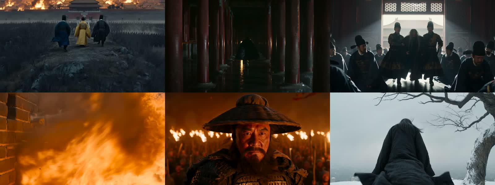

<div align="center">

# Eimu

**Say it. Get the film.**

Describe a scene, paste a chapter, or drop a product photo.
Script, characters, storyboard, voice, score, subtitles and the final cut — out of one pipeline.

[**Open the studio**](https://eimu.dev/) · [See the output](#see-the-output) · [3-minute start](#3-minute-start) · [API / MCP](#connect-it-to-your-tools) · [Docs](https://eimu.dev/docs) · [中文](README.md)

<a href="https://eimu.dev"></a>
<a href="https://eimu.dev/docs"></a>
<a href="#connect-it-to-your-tools"></a>
<a href="#connect-it-to-your-tools"></a>
<a href="https://github.com/VerenOwO/Eimu/stargazers"></a>

</div>

## See the output

<p align="center">
  
  <br>
  <sub><em>The Last Seventeen Years of the Ming</em> · 64.48s · six shots and every audio track from <strong>one canvas</strong>. It started with a chapter of a novel and one sentence: “turn this into a one-minute short.”</sub>
</p>

<p align="center">
  <video src="https://github.com/user-attachments/assets/c5d7745e-5b45-462c-8b70-a30ae618de3b" width="100%"></video>
</p>

| Input | What you say | What comes out |
| --- | --- | --- |
| A chapter | “Turn this into a one-minute short.” | A 64s film: locked characters, storyboard, voice, score, subtitles |
| One product photo | “Make a 30-second launch film.” | Storyboard, film, and crops for each ad placement |
| One face + 10 scenes | “The lead is Xiao Ming. Ten scenes.” | The same face in every shot |
| A genre in one line | “Something like F.I.R. — loud, epic.” | A full song with vocals (see [the benchmark](#evidence-not-adjectives)) |

## 3-minute start

1. Open [eimu.dev](https://eimu.dev/) and sign in with WeChat or GitHub. New accounts include roughly 5 free images; the prompt-structuring tool works without signing in.
2. Say what you want. You can paste this as-is:

   > Take this product photo and make a 30-second launch film: seaside sunset, warm golden light, four shots, brand name at the end.

3. Check the plan card and its coin cost, then run it. Voice-over, subtitles and the final cut are assembled automatically. If one shot is wrong, reopen that node, change the prompt or the model, and rerun only that node.

Or call it as a generation backend:

```bash
# OpenAI-compatible. Returns 200 only after the image is ready — no polling loop.
# Idempotency-Key: retries do not charge twice.
curl https://eimu.dev/openai/v1/images/generations \
  -H "Authorization: Bearer $EIMU_API_KEY" \
  -H "Idempotency-Key: job-001" \
  -H "Content-Type: application/json" \
  -d '{"model":"gpt-image-2","prompt":"@[character:Chongzhen] standing in the snowstorm on Meishan"}'
```

## Why Eimu

A single model can give you a good image or a five-second clip. It cannot give you a film you can ship. In a real production the script lives in one tool, character design in another, and video, voice, score and subtitles in three or four more. Change one line of dialogue and everything downstream has to be reconnected. Chat a few more turns and the lead's face changes.

Eimu puts that pipeline behind one canvas and one assistant:

| | Single model | Video editor | Workflow builder | **Eimu** |
| --- | :---: | :---: | :---: | :---: |
| One sentence → finished film | ✗ | ✗ | You build it | **✓** |
| Character consistency across shots | ✗ | Manual | You build it | **Character cards** |
| Cost of fixing one shot | Re-run the clip | Manual re-edit | Re-run the graph | **Re-run that node** |
| Know the cost before generating | ✗ | — | — | **Plan card + reserve/refund** |
| Keep working after closing the tab | ✗ | — | You build it | **Async + persisted canvas** |
| Learning curve | Low | High | High | **Just talk** |

## What it actually does

**One sentence lays out the canvas.** The assistant detects whether you need a short drama, a launch film or a song, picks the pipeline and models, and wires script, four-view character sheets, storyboard, score and compositing into nodes. Desktop gets the full 21+ node canvas; on mobile you just talk and it wires in the background.

**Chat and canvas stay in sync.** Assistant edits compile through `Descript DSL`; your manual node edits write back to the same workflow state. Every node keeps its version history; editing, matting or frame extraction never mutates the original.

**One character across the whole film.** Character four-views, scenes, styles and props are stored as entity cards. Write `@[character:Chongzhen]` and every node carries the same reference set. Complex camera work is blocked out first in a 3D director's console with Blender render nodes and 142 shot-language presets.

**Rerun one node, not the pipeline.** Cheap drafts run directly; before a paid run the plan card states the coin cost. A bad node is rerun alone. Jobs execute asynchronously in the cloud: in an adversarial test we killed the client connection at second 18; the server still completed `workflow_write` at second 54 and persisted the full canvas.

**A director that does not touch the tools.** With `BEAST_MODE=ON`, the main agent only writes acceptance criteria, required recipes and delivery contracts, then dispatches through `routeExpert`. Tool tables are physically isolated: the music director's allow-list simply does not contain image or Blender tools. Sub-agents keep their search, rewriting and sampling inside disposable sessions and return a ≤500-token summary plus a six-field delivery contract signed with `qcSignature`.

## Evidence, not adjectives

With no music-model training, a single line — “something like F.I.R., loud and epic” — produced *Against the Wind*. Scored with Tencent SongBench (arXiv:2604.25937) official evaluator and weights, in the same batch as 27 Grammy/Golden Melody-winning and classic recordings:

| | 7-axis mean | Melody | Arrangement | Musicality | Instrumental | Mix | Structure |
| --- | :---: | :---: | :---: | :---: | :---: | :---: | :---: |
| Raw YuE2 (no harness) | 6.411 | 6.45 | 6.75 | 5.70 | 6.85 | 6.70 | 6.32 |
| 27 award-winning tracks (mean) | 6.400 | 6.51 | 6.69 | 5.47 | 6.60 | 6.37 | 6.48 |
| **Eimu orchestration (4 tracks, single take)** | **6.975** | 7.38 | 7.43 | 6.16 | 7.24 | 6.97 | 7.34 |
| **Eimu “Against the Wind” (best-of-8)** | **7.418** | **7.60** | **7.87** | **6.41** | **7.51** | **7.44** | **7.85** |

Across three prompts on one channel, orchestration cut the sampling range from `0.829` to `0.436`. These scores are relative positions on one ruler; they test how orchestration tightens the floor and the variance, not that the music is “better,” and not that it beats award-winning recordings.

**Cost.** Skipping per-turn full prefill and blind end-to-end reruns, a mid-size image task costs about ¥0.09 in inference (≈600k tokens, ¥0.06) plus three generations (¥0.03), sold at ¥0.45.

**Ledger and failure.** Reserve → submit → refund on failure, with zombie-ledger self-healing and two-way reconciliation; usage-based and monthly plans. Fault injection and adversarial evaluation verify that missing tools are never invented, forged `ok:true` receipts are not trusted, and unavailable channels either fail over or report honestly.

## Models and pipelines

GPT Image · Nano Banana · Seedream / Dreamina · FLUX · Adobe Firefly · Runway · PixAI · Blender 5.2 · Veo 3.1 · Kling · Seedance 2.0 / 2.5 · Firefly Video · MiniMax · Luma Ray · avatars · lip-sync · Lyria · FlowMusic · YuE2 · multi-voice TTS

13 pipelines, 57 models, 90 agent tools. The full list and pricing live in [`src/lib/generation-model-catalog/catalog.ts`](src/lib/generation-model-catalog/catalog.ts). Models are not the differentiator; making them share one ledger, one canvas state and one failure-recovery path is.

## Connect it to your tools

Create a key in settings; the dialog gives you a paste-ready command. It bills the same account balance.

- **OpenAI-compatible API**: 31 public routes under `/openai/v1/`, including `/images/generations`. Change the base URL and existing code works.
- **Remote MCP**: `/api/mcp` brings image generation, editing, video, voice, upscaling and balance checks into Claude Code, Cursor or Codex.
- **Batch and callbacks**: `/v1/batches`, `/v1/skus`; pass `callback_url` and receive a signed callback through a transactional outbox.

```text
Endpoint: https://eimu.dev/api/mcp
Header:   Authorization: Bearer $EIMU_API_KEY
```

Endpoint tables: [API reference](docs/biz-api.md) (Chinese). Your key is the billing identity — never put it in frontend code or commit it.

## Honest boundaries

- 3D blockout as a reference image works; driving the final render directly from a 3D camera is still under validation and not claimed.
- Image entity cards work; `@` references to voice cards are still under validation.
- Upscaling redraws with a model; details change. It is not pixel interpolation.
- Not a timeline editor, not Photoshop, not a skill marketplace, not a social feed. Generation is production, not posting.

If you only want an occasional single image or a five-second clip, use a single-point model. Eimu is for people who ship continuously — dramas, story shorts, product campaigns or scores — and want the characters and pipeline from film one to carry into film two.

## Architecture

```text
Your sentence
   └─ lightweight model → Jev semantic routing / memory selection
        └─ main agent → Descript DSL → compiler → canvas DAG
             └─ expert sub-agents (tool allow-lists) → image / 3D / music / compositing
                  └─ Critic Gate → persist → voice / subtitles / final cut
```

The control plane (`src/lib/generation-core`) runs lease-based supplier scheduling, failure classification and isolation, a reserve/commit/refund ledger, transactional callback delivery, and canary/SLO observation. Correctness rests on database transactions, not on serverless instance memory.

## Local development

Requires Node.js 24+ (matching .node-version and CI), npm, and a Postgres instance.

```bash
npm install
npm run dev          # http://localhost:3000
npm test             # node:test unit and contract tests
npm run build        # production build
```

Generation requires supplier credentials, injected through environment variables; each control-plane script documents the variables it needs in its header. No credentials are stored in the repository.

## License

Core business code and proprietary pipeline recipes are proprietary; copyright belongs to the authors (Tianze Chen, Zhenhua Xu), All Rights Reserved. Third-party open-source components and their licenses are listed in [THIRD-PARTY-NOTICES.md](THIRD-PARTY-NOTICES.md).

<p align="center">
  <a href="https://star-history.com/#VerenOwO/Eimu&Date">
    
  </a>
</p>
