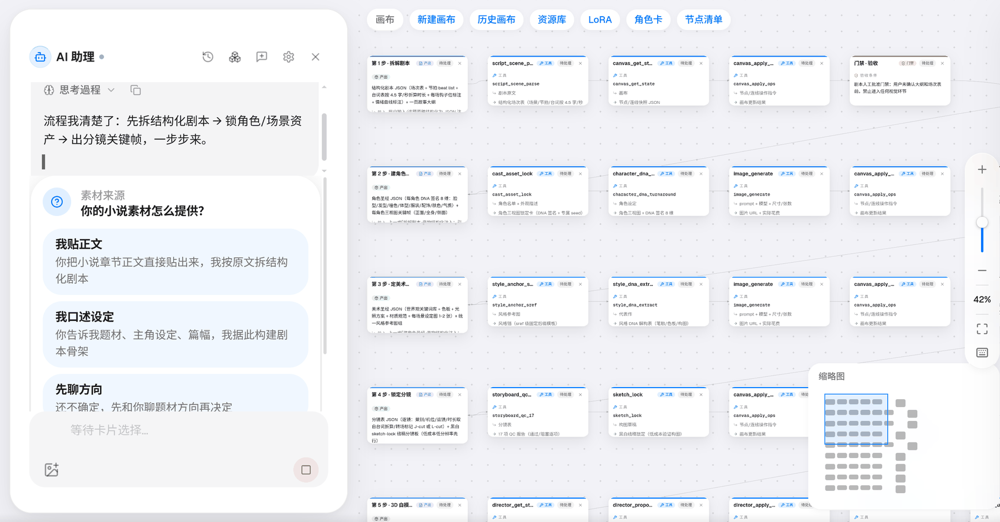
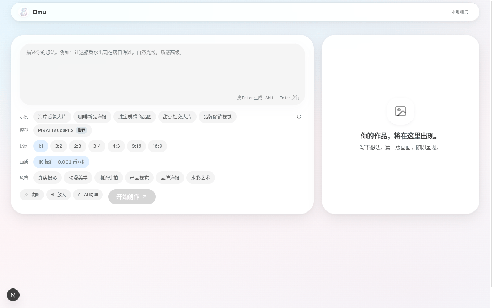
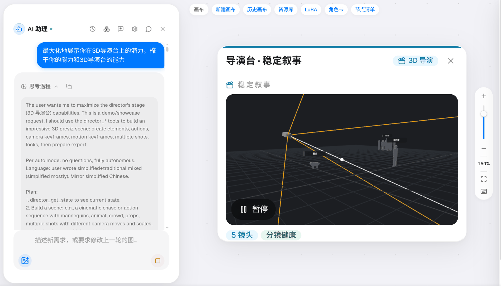

<div align="center">

# Eimu

**剪辑和分镜已经死了，现在人人都是导演。**

*Cursor of video · Vibe Directing*

给Eimu一个点子，Eimu自己设计，生成，反思，迭代，给你一段你挑剔不了的素材。

[**打开工作台**](https://eimu.dev/) · [先看成片](#先看成片) · [为什么好玩](#为什么好玩) · [证据](#证据不是形容词) · [上手](#3-分钟上手) · [文档](https://eimu.dev/docs) · [English](README.en.md)

<a href="https://eimu.dev"></a>
<a href="https://eimu.dev/docs"></a>
<a href="https://github.com/tinchak0207/Eimu/stargazers"></a>
<a href="#把-eimu-接进你的工具"></a>
<a href="#把-eimu-接进你的工具"></a>

</div>

## 先看成片

<table>
  <tr>
    <td width="34%" align="center" valign="top">
      
    </td>
    <td width="66%" valign="top">
      <video src="https://github.com/user-attachments/assets/1df9ea54-0cde-4365-9613-b1ae0a81511d"></video>
    </td>
  </tr>
</table>

<p align="center"><sub>左：我随便让它「做一个漫威级别的战斗影片，大概 15 秒。」→ Agent 想出「暴雨大坝 · 义体战士对重装机甲」。右：它做出来的影片，记得打开声音，它设计了配乐/sub></p>

<p align="center">
  <video src="https://github.com/user-attachments/assets/16b73a40-0102-4e19-b1d8-1cd0b2b88b11"></video>
  <br>
  <sub>宣传片，49 秒。点一下就播。</sub>
</p>

<p align="center">
  <video src="https://github.com/user-attachments/assets/71c8cdfb-c692-4b74-934f-3450ae5f82d2"></video>
  <br>
  <sub>完整成片，2 分 41 秒，字幕已烧录。点一下就播。</sub>
</p>

扔进去的提示词长这样：

> 「做一个漫威级别的战斗影片，大概 15 秒。」

交回来的是角色定妆、分镜、配音、配乐、字幕、成片——不是一张抽签图，不是五秒碎片，是能播的东西。左边是手机上的随口一句，右边是同一条 harness 跑完的战斗短片。

### 同一张画布的另一部演示

<p align="center">
  
  <br>
  <sub>《大明最后的十七年》· 64.48 秒 · 6 个镜头与全部音轨，出自<strong>同一张画布</strong>。起点：一段小说正文 +「把它做成 1 分钟短片」。</sub>
</p>

## 开源与商业服务

Eimu 的架构**全量开源**：站点前端、后端 API、生成控制面、Agent 网关与工具、数据库迁移、Docker / Nginx / systemd 部署模板都在本仓库，没有“开源版”与“商业版”的代码分叉。

- **许可证**：[AGPL-3.0](LICENSE)。你可以自托管、修改、分发；通过网络向第三方提供服务时，需要按许可证公开对应源码。
- **官方托管服务**：[eimu.dev](https://eimu.dev/) 继续以商业服务方式运营，提供上游模型通道、额度、存储与运维。开源的是架构与代码，不包含官方服务的容量、账号与供应商合约。
- **自托管**：见 [docs/SELF-HOSTING.md](docs/SELF-HOSTING.md)。你需要自备上游账号、Postgres 与对象存储。
- **架构说明**：见 [docs/ARCHITECTURE.md](docs/ARCHITECTURE.md)。
- **安全问题**：见 [SECURITY.md](SECURITY.md)。

## 今天拍片，像去年写代码

ChatGPT 刚出来那会儿，写代码的人把生成结果整段贴进 VS Code，改到能跑；再后来才有 Cursor——不是更好的粘贴板，是会编译、会报红、会把半成品钉死在工程里的东西。

今天拍片还停在第一阶段：微信群里用通用大模型拆一百八十镜 → 海螺 / 豆包抽签 → 剪映对口型。三次抽签换一次脸，改一句台词整条重来。

Eimu 要做的是视频这边的 Cursor：**Vibe Directing**——你凭感觉当导演，底下有一套冷酷的编译器 / harness，把「好玩」从「碰运气」里拆出来。

## 为什么好玩

好玩不是因为模型更会陪聊。好玩是因为失败被接住了，你才敢乱扔。

| 没有 harness 时 | 有 Eimu 时 |
| --- | --- |
| 提示词抽签，脸每镜一变 | 角色卡锁定，`@[角色:崇祯]` 贯穿全片 |
| 红了不知道为什么，整条重抽 | 编译器把意图钉成画布 DAG；坏了一格只重跑那一格 |
| 「听起来像歌」其实没唱词 | 音乐链路用 ASR 对词；假唱、空壳直接杀 |
| 响度忽大忽小，成片不敢放 | 导出前响度校正到约 −16 LUFS |
| 关掉网页就断 | 云端异步；断线了服务端照样落盘 |

红灯不是扫兴，是多巴胺的前提——就像代码红了才敢继续改。编译器越狠，你越敢随口扔。

### 随口一扔，整张画布落成

助理听出你要短片、单曲还是物料，选产线、选模型，把剧本、四视图角色、分镜、配乐、合成连成节点开跑。桌面是 21+ 节点的完整画布；手机上你只管说，它在后台连线。

<p align="center">
  
</p>

### 左聊右画，同一份真相

助理改画布走 `Descript DSL` 编译；你手动拖节点也会写回同一份工作流状态。每个节点留历史版本，删掉的能找回；修图、抠图、抽帧时原图不动。

<p align="center">
  
  
</p>

### 同一张脸贯穿到底

单点模型跨镜头必穿帮。人物、场景、风格、道具进实体卡；写 `@[角色:崇祯]`，整张画布带着同一组参考图。复杂机位先在三维导演台排，再出画面——内置 Blender 渲染与 142 条镜头语言。

<p align="center">
  
</p>

### 你当导演，子代理干活

开启野兽模式（`BEAST_MODE=ON`）后，主 Agent 只写验收标准、必读配方与交付契约，再 `routeExpert` 派单。工具表物理隔离：音乐导演的允许列表里本来就没有画图和 Blender。子代理的搜索、改写、采样留在子会话，用后即删，只回传短摘要和带 `qcSignature` 的交付契约。最后一道独立审片门禁（Critic Gate）过了才落盘。

<p align="center">
  
</p>

```text
你的一句话
   └─ 轻量模型接住 → Jev 语义路由 / 记忆挑选
        └─ 主 Agent → Descript DSL → 编译器 → 画布 DAG
             └─ 专家子代理（工具白名单）→ 生成 / 三维 / 音乐 / 合成
                  └─ Critic Gate → 落盘 → 文生音 / 字幕 / 成片
```

## 证据，不是形容词

### 音乐：同一把尺，和获奖录音一起量

不针对音乐做底层模型训练。输入一句「我想要一首类似飞儿乐团那种喧闹史诗风格的乐曲」，生成《逆风不灭》。用腾讯 SongBench（arXiv:2604.25937）官方评测器与权重，与 27 首格莱美、金曲奖获奖曲及经典录音同批次重跑：

| 对比项 | 七维均分 | 旋律 | 编曲 | 音乐性 | 器乐 | 混音 | 结构 |
| --- | :---: | :---: | :---: | :---: | :---: | :---: | :---: |
| 裸 YuE2（无 harness） | 6.411 | 6.45 | 6.75 | 5.70 | 6.85 | 6.70 | 6.32 |
| 27 首得奖曲均值 | 6.400 | 6.51 | 6.69 | 5.47 | 6.60 | 6.37 | 6.48 |
| **Eimu 编排（4 首单次均值）** | **6.975** | 7.38 | 7.43 | 6.16 | 7.24 | 6.97 | 7.34 |
| **Eimu《逆风不灭》（best-of-8）** | **7.418** | **7.60** | **7.87** | **6.41** | **7.51** | **7.44** | **7.85** |

编排层把单通道跨 3 题的采样极差从裸模型的 `0.829` 压到 `0.436`。分数只表示同一把尺上的相对位置，用来检验编排对下限和方差的收敛，不等于「音乐价值更高」，也不能据此推断超过获奖作品。

<p align="center">
  
</p>

## 正在做 · HYPOTHESIS

**世界种子 remix（未上线）。** 设想：公开可 fork 的画布种子——别人改一行设定（雾港旧邮局女孩 → 末日空间站守夜人），节拍、配乐曲线、机位惯性跟着继承，而不是从零抽签。叙事上这是增长核；工程上还没交到你手里。在此之前诚实标成 **正在做 / HYPOTHESIS**，不拿它当已交付卖点。

## 诚实边界

- 3D 白模作参考图出图已可用；由 3D 机位直接驱动成片仍在验证，暂不宣称。
- 图像类实体卡已可用；音色卡的 `@` 引用仍在验证。
- 放大由模型重绘，细节会变，不是像素插值。
- 导出前响度会自动校正（约 −16 LUFS）；当前是矫正器，不是「没过就硬挡导出」的 must 门——口径以现场为准。
- 不做 Photoshop；不做技能市集；不做打卡式分享墙。时间轴级「成片之后改稿不用重来」按产品决策在推进，落地前不写进首屏承诺。

只想偶尔抽一张单图或五秒视频，去用单点模型就够了。Eimu 是给想凭感觉把一部片子扔出来、还敢改第二遍的人用的。

## 3 分钟上手

1. 打开 [eimu.dev](https://eimu.dev/)，微信或 GitHub 登录。新账号自带约 5 张图的免费额度；不登录也能用免费的提示词结构化工具。
2. 直接说你要什么。第一次可以原样贴：

   > 把这张商品图做成 30 秒上市短片：海岸日落、暖金光，四个镜头，结尾出现品牌名。

3. 先看计划卡上的币数，再让它跑。跑完自动配音、加字幕、合成导出；哪一镜不顺眼，点开那个节点改词或换模型，其余镜头不动。

## 已接入的模型与产线

GPT Image · Nano Banana · Seedream / Dreamina · FLUX · Adobe Firefly · Runway · PixAI 日系 · Blender 5.2 渲染 · Veo 3.1 · Kling · Seedance 2.0 / 2.5 · Firefly Video · MiniMax · Luma Ray · 数字人 · 对口型 · Lyria · FlowMusic · YuE2 · 多音色 TTS

共 13 条产线、57 个模型、90 个 Agent 工具；完整清单与定价见 [`src/lib/generation-model-catalog/catalog.ts`](src/lib/generation-model-catalog/catalog.ts)。模型本身不是差异点——让它们走同一本账、同一套画布状态、同一套失败恢复，才是 harness 干的事。

---

<details>
<summary><strong>把 Eimu 接进你的工具 · 成本与账本 · 仓库与本地开发</strong>（细节，可跳过）</summary>

### 把 Eimu 接进你的工具

在设置页自助建 Key，弹窗直接给可粘贴的命令，扣的是同一个账号的余额。

- **OpenAI 兼容接口**：`/openai/v1/images/generations` 等 31 个公开路由，改一个 Base URL 就能接进现成代码。
- **Remote MCP**：`/api/mcp`，把生图、改图、生影片、配音、放大、查额度挂进 Claude Code、Cursor 或 Codex。
- **批量与回调**：支持 `/v1/batches`、`/v1/skus`；传入 `callback_url`，任务跑完后通过交易式 outbox 签名回调。

```bash
# 兼容 OpenAI SDK；等图生成完才回 200，不用自己写轮询
# 带 Idempotency-Key：重复请求不重复扣费
curl https://eimu.dev/openai/v1/images/generations \
  -H "Authorization: Bearer $EIMU_API_KEY" \
  -H "Idempotency-Key: job-001" \
  -H "Content-Type: application/json" \
  -d '{"model":"gpt-image-2","prompt":"@[角色:崇祯] 站在煤山风雪中"}'
```

```text
Endpoint: https://eimu.dev/api/mcp
Header:   Authorization: Bearer $EIMU_API_KEY
```

端点表见 [图像生成 API 文档](docs/biz-api.md)，调用流程见 [B 端 API 调用指南](docs/biz-api-guide.md)。密钥即计费主体，请勿写入前端代码或提交进版本库。

### 成本与账本

省掉每轮全量 Prefill 和全链路盲目重跑后，一次中等生图任务的推理（约 600k token，¥0.06）加三次生成（¥0.03），核心成本约 ¥0.09，售价 ¥0.45。

预扣 → 提交 → 失败退回，带僵尸账自愈与双向对账；支持按量计费与月费订阅。抽签式故障注入与对抗评测验证：工具不存在不编造、伪造 `ok:true` 回执不采信、通道不可用自动切备用路或如实告知。对抗评测中在第 18 秒强杀客户端连接，服务端仍在第 54 秒完成 `workflow_write`，把完整画布落盘。

### 仓库结构

| 路径 | 内容 |
| --- | --- |
| `src/app/api/v1/` | OpenAI 兼容对外面（31 个公开路由） |
| `src/app/api/` | 站点接口：生成、画布、智能体、计费、管理后台、cron |
| `src/lib/generation-core/` | 生成控制平面：租约调度、失败分类、计费账本、回调投递 |
| `src/lib/` | 模型目录、供应商注册表、计费、实体卡、画布与工作流 |
| `src/lib/agent-templates/` | 智能体产线模板池：领域模板、节点骨架与配方备注 |
| `src/components/` | 前端组件（工作台、画布、智能体面板、实体胶囊、历史） |
| `worker/` | 长驻生成 worker（与 Vercel cron 共用同一条工作循环） |
| `bridge/` | 上游桥接（Blender 桥、PixAI 桥等） |
| `tools/` | 控制面运维 CLI：迁移、播种、密钥签发、canary |
| `deploy/` | VPS 部署配置（nginx、gatus 探针、image-data-api） |
| `design-system/` | UI 设计系统权威（材料、色板、字级、间距） |
| `docs/` | 架构文档、接口文档、排障 runbook、技能文档、产品预览图 |

### 系统架构

```text
前端与对外面（Vercel）
├── src/app/                  页面：工作台、pricing、history、status、docs、admin
├── src/app/api/v1/           OpenAI 兼容接口
└── src/app/api/              站点接口：生成、画布、智能体、计费、管理后台

生成控制平面（src/lib/generation-core）
├── 供应商租约调度            数据库租约 + SKIP LOCKED，多实例并发抢单不冲突
├── 失败分类与隔离            重试 / 切换 / 隔离冷却的结构化决策
├── 计费账本                  预扣 → 提交 → 退回，僵尸账自愈与双向对账
├── 回调投递                  交易式 outbox，签名 payload 与带租约重试
└── canary 与 SLO             真实任务金丝雀、成功率与单位成本观测

创作域（src/lib）
├── character-cards           五类实体卡、别名变体与参考图绑定
├── canvas/                   画布图模型、DAG 分层布局、工作流 DSL 编译
├── agent-templates/          产线模板池与节点骨架展开
└── agent-memory-store        五类助理记忆的私有库与共享库

长驻进程（VPS）
├── worker/                   生成 worker（与 cron 同构）
├── bridge/                   上游桥接（Blender、PixAI）
└── deploy/                   nginx、gatus 探针、数据服务
```

调用链：`Controller → Service → 控制平面 → Provider / 渠道 → 上游`。所有分布式正确性建立在数据库事务上，而不是 serverless 实例的内存。

### 技术栈

| 维度 | 技术 | 版本 |
| --- | --- | --- |
| 框架 | Next.js（App Router） | 15.5 |
| UI | React | 19 |
| 语言 | TypeScript | 5.7 |
| 样式 | Tailwind CSS | 3.4 |
| 数据库 | Postgres（Supabase） | — |
| 对象存储 | Vercel Blob / 自建数据服务 | — |
| 控制面 | VPS + Docker Compose | — |
| 三维渲染 | Blender（headless，EGL） | 5.2.1 |

### 本地开发

要求：Node.js 24+（与 .node-version 和 CI 一致）、npm，以及一个可用的 Postgres 实例。

```bash
npm install
npm run dev          # 开发服务器，默认 http://localhost:3000
npm test             # 单元与契约测试（node:test）
npm run build        # 生产构建
```

生成能力需要供应商凭证，控制面运维命令通过环境变量注入数据库与凭证后执行；各脚本头部说明写明了所需变量。仓库内不存放任何凭证。

</details>

## 文档导航

| 文档 | 说明 |
| --- | --- |
| [站内文档中心](https://eimu.dev/docs) | 面向使用者的分篇教学：快速上手、助理设定与野兽模式、画布与工作流、素材复用、充值与计费、MCP 接入 |
| [架构全览](docs/ARCHITECTURE.md) | 各子系统职责与相互关系 |
| [图像生成 API 文档](docs/biz-api.md) | 接入：基址、认证、端点表与字段说明 |
| [B 端 API 调用指南](docs/biz-api-guide.md) | 调用示例与异步取结果的完整流程 |
| [基础设施排障 Runbook](docs/runbooks/infra-debugging.md) | 部署与线上问题的定位步骤 |
| [技能文档](docs/skills/README.md) | 领域配方：短剧生产、小说 IP 视觉包、电商与换装、LoRA 与风格研究 |
| [设计系统](design-system/MASTER.md) | UI 材料、色板、字级、间距与反模式 |
| [产品准则](PRODUCT.md) | 用户、定位、能力边界与产品决策原则 |
| [第三方声明](THIRD-PARTY-NOTICES.md) | 引入的第三方开源组件与许可 |

---

## 授权与 Star History

<p align="center">
  <a href="https://star-history.com/#tinchak0207/Eimu&Date">
    
  </a>
</p>

- **开源共享与商业托管**：我们公开 Eimu 的系统架构规范、Agent 隔离机制与评测结果，供多模态 Agent 社区研究参考；需要开箱可用的生产算力，直接访问 [eimu.dev](https://eimu.dev/)。
- **许可证**：[AGPL-3.0](LICENSE)。仓库内第三方开源组件及其许可见 [THIRD-PARTY-NOTICES.md](THIRD-PARTY-NOTICES.md)。
