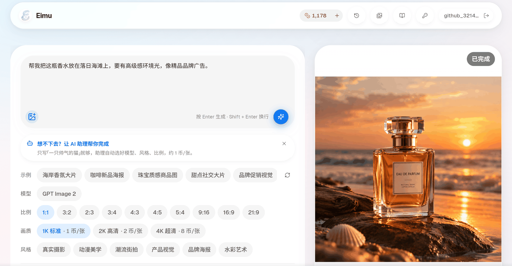
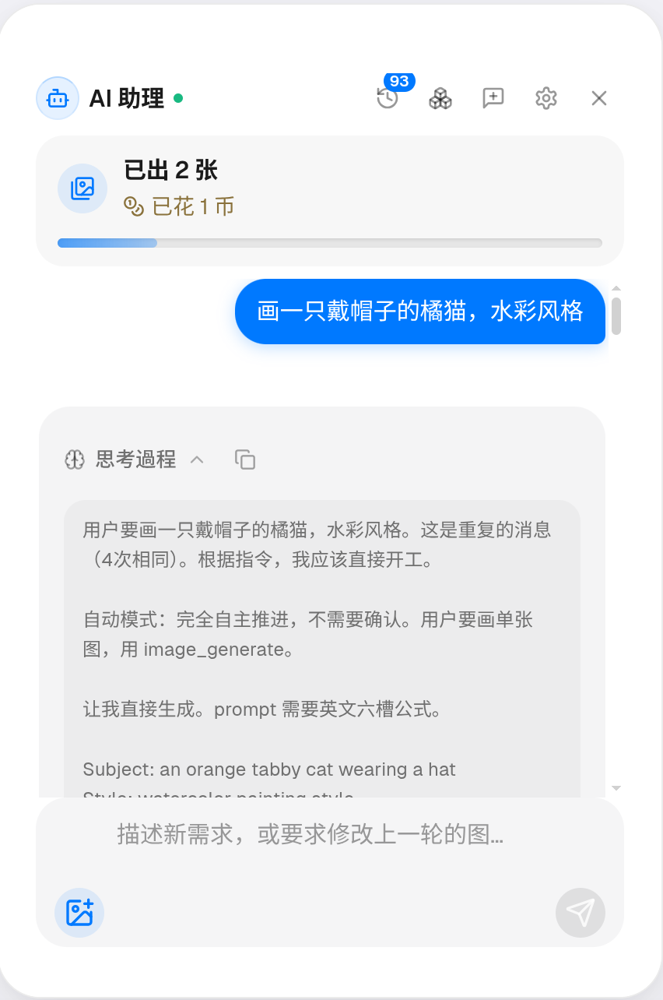
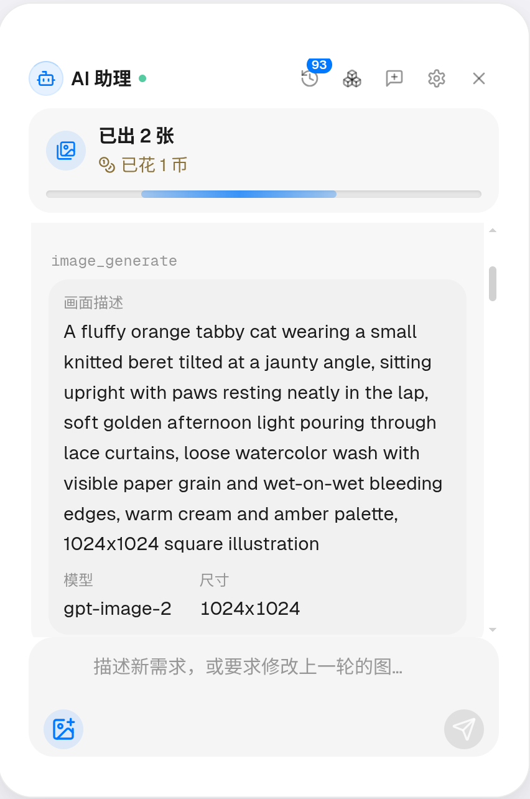
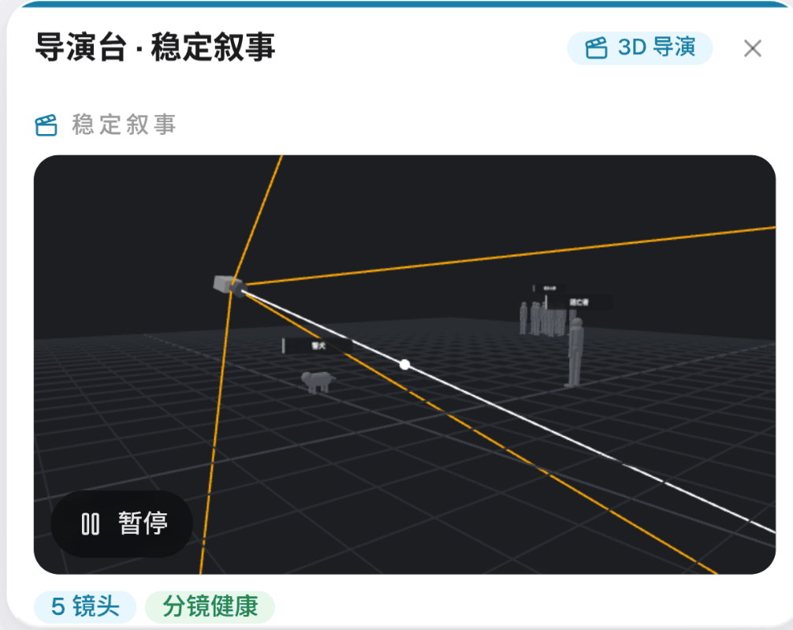
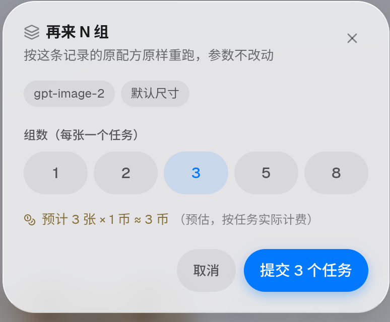
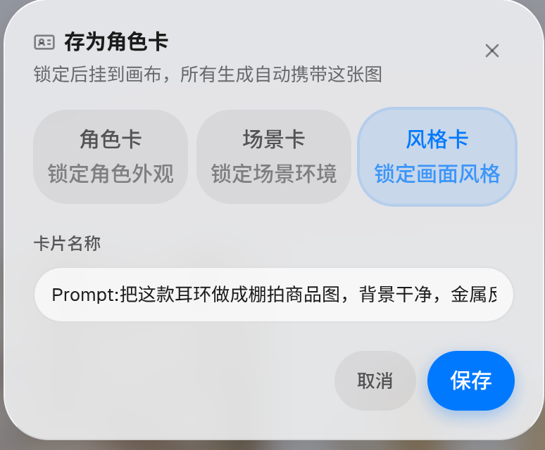

# Eimu — AI 影像生成工作台

**许愿式 AI 生图 · 生视频 · 无限画布 · 开放 API**

**简体中文**

把一句自然语言需求变成可交付的图片与视频：脚本、分镜、画面、配音、成片在同一条工作流里完成，参数由智能体承担。

<p>
  
  
  
  
  
  
  
</p>

<p align="center">
  <a href="https://eimu.dev/"><strong>在线体验</strong></a>
  &nbsp;&nbsp;·&nbsp;&nbsp;
  <a href="#快速开始"><strong>快速开始</strong></a>
  &nbsp;&nbsp;·&nbsp;&nbsp;
  <a href="https://eimu.dev/docs"><strong>API 文档</strong></a>
  &nbsp;&nbsp;·&nbsp;&nbsp;
  <a href="https://eimu.dev/status"><strong>状态页</strong></a>
</p>

<table>
  <tr>
    <td width="50%"><video src="https://github.com/user-attachments/assets/f2f78020-f1f4-4907-a024-c643f867c8d1" width="100%"></video></td>
    <td width="50%"><video src="https://github.com/user-attachments/assets/73167629-d472-468c-a552-c7b90b320d67" width="100%"></video></td>
  </tr>
</table>

<p align="center">
  <a href="#产品预览">
    
  </a><br>
  <sub>生成工作台实拍 · <a href="#产品预览">查看画布、历史、三维导演台与成片截图</a></sub>
</p>

- **闭环优先**：生成结果一定落到可见、可改、可放大、可下载、可复用的位置，用户不必在队列、画布、图库、历史之间来回找。
- **许愿式交互**：用户给愿望，智能体负责拆解、选参、批量执行与失败重试；专业工作台在此之外提供模型、LoRA、权重等精确控制。
- **实体封装**：角色、道具、场景、风格与音色统一封装成可复用实体卡，在提示词里以行内引用就地展开；被引用的实体在生成时自动带上参考图，跨镜头保持一致。
- **多供应商聚合**：Adobe2API、Sub2API、PixAI 账号池、New API 中转、Blender 渲染节点统一为一套 OpenAI 兼容对外面，能力以启用的渠道为准。

> 本项目为私有项目（Proprietary, All Rights Reserved）。使用在线服务需注册账号并充值额度；接入生成能力需配置相应供应商的 API 凭证，模型调用与存储可能产生费用。

## Eimu 用来做什么

Eimu 面向想把 AI 生成能力真正用进内容生产的人：不懂美术与剪辑基础的创作者、需要批量出图的电商与内容团队、以及想把生成能力接进自有系统的开发者。它不是单点的「生图页面」，而是一套围绕生成任务组织起来的完整系统——从最开始的一句需求，到镜头拆解、画面生成、视频生成、配音合成和成片导出，都在同一条工作流里完成。

在创作侧，Eimu 以「项目」为单位组织作品，并把其中反复出现的东西沉淀成资产：角色、道具、场景、风格与音色各自封装为实体卡，在提示词里用行内引用就地调用，生成时自动带上参考图，从而让同一角色跨分镜、跨镜头保持一致。一次生成会产出可追踪的任务记录，支持批量执行、失败重试、进度查看和结果回收；结果自动归档进历史，可筛选、可检索、可导出。画布上的人工改动会被系统记住，后续自动编排不会覆盖。

在接口侧，Eimu 把多家供应商的图片、视频、语音能力统一封装为 Provider，通过统一的任务系统、计费系统和回调机制对外提供 OpenAI 兼容的稳定接口。新增厂商或模型时复用既有的 Provider 编排、模型目录、任务记录与扣费链路，适合二次开发与私有化改造。

## 两个使用面

Eimu 同时服务创作者与开发者，两端共用同一套生成核心、计费账本与失败语义，不是两套系统。

### C 端创作工作台

面向以「得到成品」为目标的创作者。首页输入需求即可开始，智能体拆解意图、选择模型与参数、按需派发子任务；专业工作台提供模型、尺寸、LoRA、权重、采样器等精确控制；无限画布把生成、改图、放大、三维预演组织成可复用的创作图。创作过程中的角色、道具与场景可以随时锁定为实体卡，供后续所有镜头复用；助理也能在生成时直接引用这些实体。适合电商出图、海报与主视觉、角色设定、短视频素材、分镜预演与成片装配。

### B 端 OpenAI 兼容 API

面向平台与开发者。全部能力走 `sk-biz-` 密钥鉴权，接口形态与 OpenAI 一致，附带限流头、请求追踪 id 与结构化的错误码体系。图片、视频、语音均为异步提交加轮询取结果的模式，另提供批量、对账、SKU 下单、上传与放大等能力，并开放实体卡查询与解析接口，使外部系统生成的画面能与站内的角色、道具设定保持同一份来源。适合批量生产、系统对接与二次分发。

## 仓库结构

| 路径 | 内容 |
|------|------|
| `src/app/api/v1/` | B 端 OpenAI 兼容对外面（31 个公开路由） |
| `src/app/api/` | 站点接口：生成、画布、智能体、计费、管理后台、cron |
| `src/app/api/biz/` | B 端专用接口：实体卡查询与解析 |
| `src/lib/generation-core/` | 生成控制平面：租约调度、失败分类、计费账本、回调投递 |
| `src/lib/` | 模型目录、供应商注册表、计费、实体卡、画布与工作流实现 |
| `src/lib/agent-templates/` | 智能体产线模板池：领域模板、节点骨架与配方备注 |
| `src/lib/aid-enums/` | 分镜与镜头语言的枚举契约、词库与状态机定义 |
| `src/components/` | 前端组件（工作台、画布、智能体面板、实体胶囊、历史） |
| `src/app/` | 页面（首页、pricing、history、status、docs、admin） |
| `worker/` | 长驻生成 worker（与 Vercel cron 共用同一条工作循环） |
| `bridge/` | 上游桥接（Blender 桥、PixAI 桥等） |
| `tools/` | 控制面运维 CLI：迁移、播种、密钥签发、canary |
| `deploy/` | VPS 部署配置（nginx、gatus 探针、image-data-api） |
| `design-system/` | UI 设计系统权威（材料、色板、字级、间距） |
| `docs/` | 架构文档、接口文档、排障 runbook、技能文档、产品预览图 |

## 功能特性

**AI 创作全流程**

- 文生图与图生图：多模型可选，参考图按各模型真实能力安全编排
- 实体卡片与行内引用：角色、道具、场景、风格、音色五类实体各自成卡，可绑定参考图与别名变体；在提示词里以 `@[种类:名称]` 行内引用，命中即在生成时就地展开为对应参考图，聊天正文与画布节点上渲染成左带微缩图的实体胶囊
- 无限画布：DAG 分层自动排版（按依赖深度分栏、压交叉、衍生卡走垂直脊柱）、语义连线与跨界桥接路由、非破坏性像素编辑（裁剪／切分／抠图／旋转，结果作为新子节点落回），原节点不动
- 工作流 DSL：智能体对画布的多步编排写成整份声明式 DSL，由站点编译器全图校验后原子套用；图是唯一运行时真相，DSL 往返幂等
- 产线模板：一句话需求先经判定层选中对应产线，再一次性展开成整张创作图；模板覆盖短剧、小说改编、电商、角色设定、场景搭建、海报、单图与单视频等 13 条产线，除主链节点外还自动衍生工具卡、配方卡与门禁卡
- 工作流记忆与 PNG 载体：prompt、负向词、尺寸、风格、参考图角色、区域 prompt 一键复原；整套配置可嵌入 PNG 文件尾部，图片本身即工作流的载体；工作流完成后的产线经验按类型沉淀进助理记忆库
- 分镜与创作流水线：作品／剧集／分镜三级状态机、分镜实体 21 栏位契约、142 条 / 12 类镜头语言词库与选词入口，成片前的镜头设定由系统按契约机械校验
- 视频生成：图生视频、首尾帧、多镜头批量出片，清晰度、时长与比例按模型能力校验，单镜时长按分段计价规则取满
- 三维导演：Blender headless 作为一条正式供应商渠道接入租约调度，智能体以机位与运动语言描述镜头，渲染模型进入统一模型目录
- 配音与后期：TTS 配音、对口型；字幕分屏、时间线剪辑、混音与成片导出由智能体自主执行，成片登记带幂等指纹
- 审核与把关：独立的审核官角色对提示词与产物做契约级机械检查，越界当场打回
- 生成历史：时间分组、检索筛选、多选操作、三格式导出（ZIP／JSON／CSV），取不到的图跳过并计数，不因单张失败中断整个导出；工作流任务同样进历史并带 DAG 缩图与费用

**平台能力**

- 多供应商编排：文本、图片、视频、语音模型通过统一 Provider 接入，能力、参考图数量、分辨率、时长、比例均可配置
- 统一任务系统：生成任务排队、并发调度、进度推送、失败重试、补偿与结果回收
- 失败分类器：供应商错误被分类为可重试、切换供应商、隔离并冷却等结构化决策；连续系统性错误进入隔离与冷却计时，而不是无界重试
- 重试体验：重试过程以「重试中（x／N）」队列帧呈现而非抛错，重试成功后钉住可用渠道走快路，失败切换时自动解钉
- 门禁式健康探测：供应商账号须同时满足凭证来源、刷新状态、未过期与成功率门槛才进入候选，不健康者不进候选
- 视觉一致性：角色、场景、风格以实体卡为单位复用，项目风格快照与生成链路共用同一套表示
- 智能体记忆库：用户偏好、反馈、项目、领域知识与工作流经验五类长期记忆，分私有库与共享库，按需检索注入
- 计费体系：按模型与分辨率映射到统一币制，跨模型可比较、可对账；套餐、余额、密钥额度与改图、放大、模板全部跑在同一套币制上
- 计费账本：执行前预扣、成功提交、失败退回三态；僵尸账到期自愈回收；与上游账本双向对账
- 分层定价：按密钥或租户挂 tier，对模型与分辨率覆写绝对币价，同时涵盖加成与拿货价两种语义
- 账户与增长：四轨登录（GitHub OAuth／Google OAuth／微信扫码／OAuth 回环授权）、每日签到、充值套餐、兑换码、联盟营销；充值回调按手续费容差校验，实收不低于应收即放行，不接受的分支全部留痕
- 运营管理：模型、供应商、账号池、智能体、内容、订单、用户、存储与平台配置统一管理
- 生产运维：Vercel 无状态前端与控制面、VPS 长驻 worker 与上游适配，两种形态消费同一条工作循环；部署前跑生产与版本库对账，漂移即挡
- 可观测性：路由遥测、任务时间线探针、滞留任务探测、按租户与模型维度的成功率与延迟观测

## 系统架构

```text
Eimu
├── 前端与对外面（Vercel）
│   ├── src/app/                  页面：首页工作台、pricing、history、status、docs、admin
│   ├── src/app/api/v1/           B 端 OpenAI 兼容接口
│   ├── src/app/api/              站点接口：生成、画布、智能体、计费、管理后台
│   └── src/app/api/cron/         定时任务入口（worker 循环）
├── 生成控制平面（src/lib/generation-core）
│   ├── 供应商租约调度            数据库租约 + SKIP LOCKED，多实例并发抢单不冲突
│   ├── 失败分类与隔离            重试 / 切换 / 隔离冷却的结构化决策
│   ├── 计费账本                  预扣 → 提交 → 退回，僵尸账自愈与双向对账
│   ├── 回调投递                  交易式 outbox，签名 payload 与带租约重试
│   └── canary 与 SLO             真实任务金丝雀、成功率与单位成本观测
├── 路由与供应（src/lib）
│   ├── channel-registry          渠道唯一事实来源，被队列、熔断与路由测试锁定
│   ├── supplier-channels         渠道注册表与 adapter 分派
│   └── generation-model-catalog  模型、分辨率、能力与定价目录
├── 创作域（src/lib）
│   ├── character-cards           五类实体卡、别名变体与参考图绑定
│   ├── canvas/                   画布图模型、DAG 分层布局、工作流 DSL 编译
│   ├── agent-templates/          产线模板池与节点骨架展开
│   ├── aid-enums/                分镜 21 栏位契约、镜头词库与流水线状态机
│   └── agent-memory-store        五类助理记忆的私有库与共享库
├── 长驻进程（VPS）
│   ├── worker/                   生成 worker（与 cron 同构）
│   ├── bridge/                   上游桥接（Blender、PixAI）
│   └── deploy/                   nginx、gatus 探针、数据服务
└── 存储
    ├── Postgres                  任务、租约、计费、回调、用户状态
    └── Blob                      双后端可切换，对调用方同一组签名
```

调用链：`Controller → Service → 控制平面 → Provider / 渠道 → 上游`。所有分布式正确性建立在数据库事务上，而不是 serverless 实例的内存。

## 技术栈

| 维度 | 技术 | 版本 |
|------|------|------|
| 框架 | Next.js（App Router） | 15.5 |
| UI | React | 19 |
| 语言 | TypeScript | 5.7 |
| 样式 | Tailwind CSS | 3.4 |
| 数据库 | Postgres（Supabase） | — |
| 对象存储 | Vercel Blob / 自建数据服务 | — |
| 前端托管 | Vercel | — |
| 控制面 | VPS + Docker Compose | — |
| 三维渲染 | Blender（headless，EGL） | 5.2.1 |
| 测试 | node:test | — |

## 快速开始

### 在线使用

访问 [eimu.dev](https://eimu.dev/) 注册账号即可开始，支持 GitHub、Google、微信扫码与 OAuth 回环授权四种登录方式。首页输入需求直接生成；需要与助理来回沟通、让它选模板并派发子任务时使用 AI 助理；需要精确控制时切换到专业工作台；需要多步编排与实体复用时使用画布。站内[文档中心](https://eimu.dev/docs)按助理设定、工作流与画布、历史素材复用、充值与计费、把助理带走（MCP 接入）分篇讲解。

### B 端 API 接入

接口基址与密钥签发方式见 [B 端 API 调用指南](docs/biz-api-guide.md)，完整的端点表与参数说明见 [图像生成 API 文档](docs/biz-api.md)。

```bash
curl -X POST https://eimu.dev/v1/images/generations \
  -H "Authorization: Bearer $EIMU_API_KEY" \
  -H "Content-Type: application/json" \
  -d '{"model":"gpt-image-2","prompt":"a premium skincare bottle on a soft ivory background"}'
```

提交返回任务 id，随后轮询状态与取结果：

```bash
curl https://eimu.dev/v1/images/<id>          -H "Authorization: Bearer $EIMU_API_KEY"
curl https://eimu.dev/v1/images/<id>/result   -H "Authorization: Bearer $EIMU_API_KEY"
```

除图片、视频、语音外，对外面还提供批量任务与对账、SKU 下单与取件、上传、放大、模板生成、模型目录与队列状态查询，以及实体卡查询与解析——使外部系统生成的画面能与站内的角色、道具设定共用同一份来源。完整端点表见[图像生成 API 文档](docs/biz-api.md)。

密钥即计费主体，请勿写入前端代码或提交进版本库。API 密钥丢失或泄露只能吊销重签，请妥善保管。

### 本地开发

要求：Node.js 20+、npm，以及一个可用的 Postgres 实例。

```bash
npm install
npm run dev          # 开发服务器，默认 http://localhost:3000
npm test             # 单元与契约测试（node:test）
npm run build        # 生产构建
```

生成能力需要供应商凭证，控制面运维命令通过环境变量注入数据库与凭证后执行，各脚本的头部说明写明了所需变量。生产环境的数据库、供应商凭证与支付凭证不得使用示例值；仓库内不存放任何凭证。

## 文档导航

| 文档 | 说明 |
|------|------|
| [站内文档中心](https://eimu.dev/docs) | 面向使用者的分篇教学：快速上手与一轮对话流程、助理设定与野兽模式、工作流与画布、历史素材复用、充值与计费、把助理带走（MCP 接入） |
| [架构全览](docs/ARCHITECTURE.md) | 导览式架构说明：各子系统职责与相互关系 |
| [图像生成 API 文档](docs/biz-api.md) | B 端接入：基址、认证、端点表与字段说明 |
| [B 端 API 调用指南](docs/biz-api-guide.md) | 调用示例与异步取结果的完整流程 |
| [基础设施排障 Runbook](docs/runbooks/infra-debugging.md) | 部署与线上问题的定位步骤 |
| [技能文档](docs/skills/README.md) | 领域配方：短剧生产、小说 IP 视觉包、电商与换装、LoRA 与风格研究 |
| [设计系统](design-system/MASTER.md) | UI 材料、色板、字级、间距与反模式（视觉权威） |
| [产品准则](PRODUCT.md) | 用户、定位、能力边界与产品决策原则 |
| [第三方声明](THIRD-PARTY-NOTICES.md) | 引入的第三方开源组件与许可 |

## 产品预览

> README 中的图片均使用仓库相对路径引用，可在 GitHub 网页端直接渲染。

### 生成工作台与创作闭环

需求输入、参数选择与结果呈现收束于同一界面；一句自然语言需求发出后，整张创作图一次性落成，而不是逐节点堆叠。

| 一句需求 → 整张创作图 | 无限画布 |
|---|---|
|  |  |

### 智能体与参数透明

口语化描述与系统实际提交的提示词同屏可对照，参数与费用在界面可见。

| 用户原句 | 系统实际提交的提示词 |
|---|---|
|  |  |

### 三维导演台

三维导演自行编排场景、机位与运动路径，分镜状态由系统自动校验。

| 三维预演与机位路径 | 自主编排的三维场景 |
|---|---|
|  |  |

### 历史、复用与导出

结果自动归档，按时间分组，支持检索、筛选与多选；复用动作为「再来 N 组」与「微调变体」两条按原配方重跑并预先报价，另有「存为资产」把结果与提示词沉淀进资产库，以及锁定为角色、场景、风格、道具、音频五类实体卡。

| 生成历史 | 再来 N 组 / 存为卡片 |
|---|---|
|  |   |

### 生成成品

<p align="center">
  
  
</p>

<p align="center">
  
</p>

## 支持的模型谱系

模型目录（`src/lib/generation-model-catalog/catalog.ts`）共 **57 个条目**，分为 image / video / audio 三类。

**影像（29）**：GPT Image（2 / 1.5 / 初代 / 2.5 Flare / 2.5 Sunburst）、Nano Banana 系列（Nano Banana / Pro / 2）、Dreamina 系列（Image 5 Pro / Lite、Seedream 2.0、Seedream 5.0 Pro / Lite）、Agnes Image 2.5 Flash、Adobe Firefly Image 5、FLUX 系列（FLUX.2 / FLUX.2 Pro / Kontext Pro / Kontext Max / 1.1 Pro / 1.1 Pro Ultra）、Runway Gen-4 Image、PixAI 日系系列（Tsubaki.2 / Tsubaki v1.1 / Haruka v2 / Hoshino v2 / Reference Pro）、Blender 渲染（EEVEE / Cycles）。

**影像工具型条目（4）**：智能扩图、改图（Image Edit）、图像放大（2x Upscale）、模板生成（Template）。

**视频（23）**：Veo 3.1（含 Fast）、Kling（2.5 Turbo / 3.0 / 3.0 Omni）、Seedance 2.0（含 Fast / Mini）、Seedance 2.5（480p / 720p / 30s）、Runway Gen-4 / Gen-4.5、Adobe Firefly Video、MiniMax H3、Luma Ray 系列（Ray2 / Ray2 Flash / Ray3 / Ray3 HDR / Ray3.14 / Ray3.14 HDR）、Avatar 1（数字人）、Lipsync 1（对口型）。

**语音（1）**：TTS 1。

模型本身不是产品的差异点——让 57 个模型通过同一套计费、同一套失败语义、同一套稳定性观测可靠地交付出去，才是这项工作的主体。

## 有意不做的事

- 不做「分享墙」式的社交功能：生成是生产行为，不是打卡。
- 不做 Photoshop 式的全功能编辑器：画布的像素编辑只覆盖生成闭环所需，复杂修图交给模型重绘。
- 不自建第二套计费系统：上游账本可信就复用它，避免同一份信用额度在两处互相打架。
- 不让管理后台的显示与生产实际分家：后台展示的账号状态、路由事件与失败原因与生产同源。
- 不提供「看起来能保证、实际不能保证」的控件：凑不出可复现参数时不给出锚定按钮，解析不了被截断的参数时显示原文而不是补全成看似完整的参数表。
- 不静默吞掉解析失败的引用：提示词里的实体引用拼错或指向已删除的卡片时，按原文照留并就地警示，不假装引用生效。

## 授权声明

本项目为私有项目（Proprietary），版权归作者所有，All Rights Reserved。仓库内包含的第三方开源组件及其许可见 [THIRD-PARTY-NOTICES.md](THIRD-PARTY-NOTICES.md)，原有版权与许可声明予以保留。
