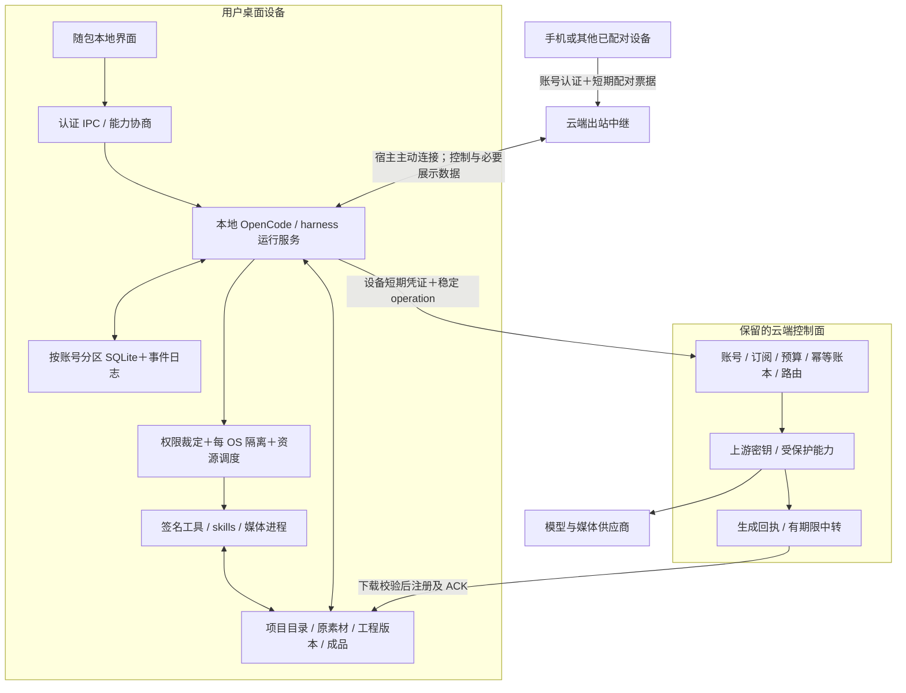

# Eimu 本地 Agent 总体 PRD

版本：v1.0 方案稿。日期：2026-11-25。适用对象：产品、桌面端、Agent、控制面、媒体工具与发布负责人。

**把完整 Agent 循环、作品和历史迁到用户设备；VPS 收缩为授权、计费、路由和涉密能力。**这是用户已经确定的方向。本稿给出实现这一方向的总体产品合同，技术边界和分阶段范围属于拟定决策，不能视为用户已经逐项批准。保留现有 Electron、OpenCode/harness 和“自主研究→策划→工具执行→独立评审→返工→可编辑交付”，借鉴 Codex、Claude Code 的成熟运行机制，不替换为它们的 SDK。完成标准是用户安装真实发行包，用自己的素材得到可编辑工程和成品，退出、断网、恢复及换号后仍保持任务、文件和账本一致。只把下载、转码或聊天界面搬到本机，不算完成。

## 1. 目标、用户与明确边界

面向已有电脑的个人创作者、小型商业团队，以及经常把本地素材交给 Eimu 制作的人。核心任务是说出目标、提供必要素材和授权，让 Agent 自主完成研究、创作及修改；用户可以随时拿走工程，继续编辑。已有用户的账号归属、同账号历史和资产连续性必须保全，不能以迁移为由消失。

产品目标有四项：完整创作闭环在本地运行；项目和历史拥有可恢复的本地权威副本；重算和媒体传输尽量绕开 VPS；云端继续可靠裁定身份、预算、账本和供应商调用。成本下降是待测结果，不写“节省 90%”。Agent 在云端也不必每人占一台服务器，本次改变的是共享服务器承担的工作和数据责任。

明确非目标：要求用户安装本地大模型、Docker、开发环境或配置端口；把自动 Agent 缩成填表、手拼提示词或素材搬运器；重写全部媒体工具；恢复已撤下的 ProjectGraph 引擎；承诺手机拥有电脑的本地重算能力；默认建立云端全量历史或长期作品仓；为迁移顺便更换基础模型和框架。已有网页入口继续承担账号和过渡服务，不能用网页仍可打开证明本地 Agent 已完成。

本稿把运行地、推理地和数据权威分开：Agent 编排及工具进程在本地，模型推理可以经云端代理或供应商执行，本地保存的历史与工程是内容权威。**本地执行不等于内容从不出设备。**凡调用云模型，所需上下文会离开设备；Eimu 推理代理瞬时接触内容也属于云处理。

## 2. 从成熟产品借机制，不借未经证明的保证

下表“事实”来自本次实读的官方文档或固定版本源码，未亲测其产品。Codex 公开源码固定在 `3f65e9f13165d85d1b1fbe20ce06c55758f927b9`；Claude Code 仅使用官方公开契约，不使用泄漏源码。右栏是 Eimu 的拟议规范。

| 成熟机制与事实 | 对 Eimu 的含义 | 对应需求 |
|---|---|---|
| Codex app-server 分离客户端连接、会话与回合，要求初始化协商；部分网络接口仍有实验和鉴权边界 | 使用认证 IPC 和能力协商，不把实验接口直接公开到公网 | R02、R29 |
| Codex rollout 记录持久化并处理 I/O 故障；恢复选择可用 compaction 边界 | 保存原始日志、来源范围和恢复位置；快照＋增量游标由 Eimu 明确定义 | R04—R06 |
| Claude 按项目保存 transcript，支持继续、恢复和分支 | 继续同一项目不重开任务；恢复先对账，不能自动重放外部操作 | R04、R16 |
| 两者区分审批与操作系统隔离；Claude 部分工具不自动覆盖在 Bash 沙箱内 | **权限≠sandbox**；统一执行裁定，逐类确认实际隔离范围 | R09—R11 |
| Claude checkpoint 只覆盖所跟踪的内容，存在外部修改和并发遗漏 | **checkpoint≠退款**；工程版本、对话分支、订单账本分别恢复 | R08、R17 |
| Codex 中断调用任务取消及清理；子代理有实际执行限额 | 停止必须落到任务代、队列、进程和子代理 | R12—R14 |
| Claude subagent 独立上下文和权限，共用用量约束 | 保留研究与独立评审，资源上限由调度器统一裁定 | R07、R12 |
| Claude Remote Control 在本机执行、出站连接；连接期间 transcript 存云，按其数据使用政策保留 | **remote control≠云执行**；只借设备授权和中继形态，不照搬云存全史 | R23—R25 |
| Codex、Claude 都提供会话恢复，公开材料未证明媒体订单恰好执行一次 | **resume≠外部副作用可重投**；稳定 operation 与云端回执另建合同 | R15—R18 |

依据：[Codex App Server](https://learn.chatgpt.com/docs/app-server)、[rollout writer 固定源码](https://github.com/openai/codex/blob/3f65e9f13165d85d1b1fbe20ce06c55758f927b9/codex-rs/rollout/src/recorder.rs#L1740)、[恢复固定源码](https://github.com/openai/codex/blob/3f65e9f13165d85d1b1fbe20ce06c55758f927b9/codex-rs/core/src/session/rollout_reconstruction.rs#L64)、[Codex 安全](https://learn.chatgpt.com/docs/agent-approvals-security)、[Claude 会话](https://code.claude.com/docs/en/sessions)、[Claude 沙箱](https://code.claude.com/docs/en/sandboxing)、[Claude 恢复点](https://code.claude.com/docs/en/checkpointing)、[Claude 远控](https://code.claude.com/docs/en/remote-control)。

本稿不把 SDK hosting 当成“必须一人一台服务器”的证据。Claude SDK 的会话可以是 CLI 子进程和进程树，持久化另有责任；开源 Codex 范围也不等于全部闭源桌面产品。[Claude Hosting](https://code.claude.com/docs/en/agent-sdk/hosting)、[Codex 开源范围](https://learn.chatgpt.com/docs/open-source)。

## 3. 当前基底：先合能力并集，再搬运行位置

以下是本轮研究读取的工作树事实和标明日期的历史证据，未运行当前安装包，不能当作今日线上验收结果。尤其不能把“源码存在”写成“用户已经能用”。

| 领域 | 现状证据 | 本轮处理 |
|---|---|---|
| 完整自主创作链 | 已有 skills、plugin、子代理和 timeline 工具 | 保留全链，锁定跨分支能力并集 |
| 桌面界面 | `main.js` 加载远端站点，全部窗口关闭后退出 | 改为随包 UI，分开窗口与服务寿命 |
| Agent 执行 | OpenCode 4096、工具 8081，云端工作目录硬编码 | 保留引擎，改造路径、通信和生命周期 |
| 对话与任务 | 服务端全史权威，localStorage 是按账号截断缓存 | 本地 SQLite 与日志成为权威，兼容旧史导入 |
| 本地媒体 | worker 有探测/抽帧/转码；W4 adapter 无生产消费者 | 接真实入口，不能按文件存在宣布完成 |
| 工程与素材 | 云 workspace、artifact store；交付有 owner/hash 校验 | 本地项目目录权威，复用交付数据契约 |
| 原生工具 | ffmpeg、Python、bwrap 等依赖 Linux 环境 | 每 OS 分发和隔离适配，禁止直接照搬 |
| Shotcut 后期 | 11-24 历史记载另一分支/线上已接入；当前树缺 CLI | 先找回真实实现合入，不另造缩水版本 |
| ProjectGraph | 当前仅遗留 types/constants/fixtures；引擎已撤下 | 不把旧文档当现成引擎，不借迁移重建 |
| 身份与隐形输入 | 已验证 user.id；建会话注入画像、教训和资产 | 明确归属和同步来源，迁移不得漏接 |
| 生成和账本 | 有 tenant 幂等、reserve、submit_unknown、在途取消语义 | 云端保留权威，本地持订单引用 |
| 发行和升级 | Linux tar.gz target 与 AppImage 清单/updater 冲突；Windows 版本落后，Mac 无下载 | 统一真实发行清单，逐平台验安装与恢复 |

可定位的当前证据：[桌面入口](/home/lenovo/Desktop/image-app/desktop/main.js:62)、[聊天持久化](/home/lenovo/Desktop/image-app/src/lib/agent-chat-persistence.ts:1)、[本地媒体适配器](/home/lenovo/Desktop/image-app/src/lib/local-media-worker.ts:1)、[沙箱](/home/lenovo/Desktop/image-app/deploy-staging/opencode-runtime/lib/sandbox.ts:30)、[账本状态](/home/lenovo/Desktop/image-app/src/lib/generation-core/job-repository/write.ts:367)、[交付校验](/home/lenovo/Desktop/image-app/deploy-staging/gateway/artifact-delivery.ts:72)、[桌面发行清单](/home/lenovo/Desktop/image-app/src/lib/desktop-releases.ts:43)。跨分支边界见 [Shotcut 历史](/home/lenovo/.claude/memory/notes/2026-11-24-cli-anything-shotcut-integration.md) 和 [ProjectGraph 撤下记录](/home/lenovo/.claude/memory/notes/2026-11-04-projectgraph-engine-rolled-back-head-status-h09.md)。

10-04 的“只搬 I/O、循环留云”属于旧范围，已被本轮用户方向取代；其权限、真实安装包和空接线教训继续有效。账号同步旧承诺仍有效，不能顺手删掉。云端与本地基底须双向比较，产出唯一 candidate manifest 后再迁移。

## 4. 总体架构与事实权威

| 对象 | 唯一权威与写者 | 副本、过期与恢复 |
|---|---|---|
| 账号/订阅/设备撤销 | 云端身份服务 | 本地短期缓存；过期停止新云调用，不锁本地作品 |
| 对话/研究/计划/任务 | 当前执行宿主的本地运行服务 | SQLite 事务及可恢复日志；远端展示是副本 |
| 原素材/工程/人工修改 | 用户项目目录与项目清单 | 相对引用、哈希、工程版本；不由模型文字覆盖事实 |
| 订单/预算/收费/退款 | 云端账本 | 本地仅缓存回执；未知时查询云端，不猜余额 |
| 供应商任务 | 云端持有的 provider 回执及供应商查询 | 本地引用 operation/job；丢响应保留 unknown |
| 结果已落地 | 本地注册的 artifact 与校验事实 | 云知道 delivery ACK，不凭生成完成代替交付 |
| 执行租约与控制权 | 云端分配单调 execution_epoch/fencing token，宿主持任务代 | 首版仅同宿主远控与显式迁机；新副作用及共享提交验证 epoch，租约过期不代表旧进程已死 |
| 能力和版本 | 签名 candidate manifest | UI/runtime/tools 等均从同一清单派生，拒绝混装 |

云端按请求类别验证 owner、能力及安全状态，不能信任本地客户端自称“已授权”。新付费操作另查预算和消费资格；旧订单查询、对账、下载、ACK、账单和必要售后不以当前余额或有效订阅为门槛。凭证撤销后可要求正当账号重新认证，履约义务不因此消失。共享密钥留云；可公开的技能和适配器随包分发。必须保密的 prompt 或策略封装为受保护云能力，只回所需结果。任何已发到本地或模型上下文的 prompt 都不能保证不可提取，不许作绝对保密承诺。

## 5. 用户路径必须连续

安装后，用户直接打开本地界面。首次云能力使用通过原生系统浏览器登录，回到应用换取设备凭证；不要求命令行配置。选定项目目录后，Agent 可以读授权素材、建立项目和研究任务。自动授权失败时，界面按原因给出“登录”“重新连接”“选择文件夹”或受限模式入口，保留原目标和队列，不能只说“稍后重试”。这是旧设备票据事故留下的硬约束。[历史证据](/home/lenovo/.claude/memory/notes/2026-10-11-device-token-proxy-missing-body-502.md)。

首作保持完整自主链。研究人员有来源和独立上下文；制作人员使用本地素材，必要时调用云生成；独立评审能要求返工。进度显示当前动作、执行设备、等待网络/资源/权限的原因。完成同时交出可播放成品、可编辑工程及素材清单，真实路径可直接打开。

用户要求“只改第三个镜头”时，Agent 从当前工程版本建立派生版本；用户锁定或人工改过的内容不能被旧计划、子代理和迟到回调覆盖。出现冲突保留两份并说明冲突处，由用户决定内容，不把整份工程回滚。

暂停阻止新本地动作并安全收口；取消撤销当前任务代和未提交队列。窗口关闭、退出服务、休眠、断电分别呈现真实影响。已经提交的云生成仍能完成，恢复后按原回执接回，不因重新打开应用再买一次。手机通过已配对宿主查看和控制；宿主离线明确等待设备，不能假称云端接管。换号时切断旧上下文、UI 和在途注入；旧账号项目文件保留，B 账号不会自动读取 A 的项目。

## 6. 产品需求：32 项可追踪合同

P0 是对应切流阶段的阻断项；P1 可后置，但不能用后置掩盖旧能力损失。以下均为本稿拟议规范。

| 编号 | 优先级 | 需求与可观察行为 |
|---|---|---|
| R01 | P0 | 安装包包含可离线打开的 UI、运行服务及该平台所需依赖；安装到首作无 Docker、端口配置或复制 prompt。缺依赖定位到可恢复动作。 |
| R02 | P0 | 窗口、运行服务、外部订单独立生命周期；明确关闭/退出/后台行为，单实例管理、认证 IPC，禁止匿名公网本地端口。 |
| R03 | P0 | 本地状态按已验证 account ID 分区，设备 ID 不代替账号；账号 epoch 隔离迟到结果、缓存、画像、资产及在途流。 |
| R04 | P0 | SQLite 在同一事务保存业务状态与权威事件；事件带序号、版本、校验和，文件日志是可重建导出。成功确认前耐久提交；磁盘失败不伪报已保存。 |
| R05 | P0 | UI 断线采用快照版本＋增量游标恢复，再接实时事件；重连不漏消息、不重复展示。此合同是 Eimu 拟议，不声称竞品已保证。 |
| R06 | P0 | compaction 只改变模型输入，保留原始消息、研究材料、来源、工具回执和用户修改；摘要记录覆盖范围及版本，可重建。 |
| R07 | P0 | 完整保留自主研究、策划、执行、独立评审、返工与交付；主代理/研究/制作/评审有独立上下文和明确资产读写权。 |
| R08 | P0 | 工程采用相对资产引用、内容哈希、版本清单与人工修改标记；锁定内容不可被自动覆盖，冲突形成派生版本。 |
| R09 | P0 | 项目目录、网络、工具、付费分别裁定；full/auto 来自真实设置和作用域，模型文本不扩权；撤销即时阻断后续动作。 |
| R10 | P0 | 每 OS 声明并落实文件、网络与子进程隔离，覆盖 shell、MCP、hooks、媒体工具实际边界；symlink 校验请求路径及真实目标，防越根。 |
| R11 | P0 | 沙箱不可用不得静默裸跑；给出修复或明确受限能力。项目带来的 hook/MCP/skill 默认不执行，签名、来源、版本及信任范围可查可撤销。 |
| R12 | P0 | 调度器统一控制子代理和媒体 CPU/RAM/IO/GPU/网络及模型并发；资源紧张排队让出前台交互，不删研究评审来追速度。 |
| R13 | P0 | 暂停、取消带 task generation，撤销队列与控制令牌并停止可停止子进程；旧回调只能登记事实，不复活被取消工作。 |
| R14 | P0 | 崩溃/休眠恢复先核查本地子进程与外部订单；区分可续跑、需重启步骤、待对账，恢复不是无条件重放。 |
| R15 | P0 | 首次付费外部提交前，云端耐久登记 account＋operation＋参数摘要＋预算预留；重复请求返回同一操作，参数冲突拒绝。 |
| R16 | P0 | 提交超时进入 submit_unknown，沿原身份查询回执和供应商；没有可安全重试证据不重投，不承诺供应商不支持的 exactly-once。 |
| R17 | P0 | 生成、交付、收费/退款独立记账；回退工程不退款，取消不虚构撤单；可查看原订单和实际收费事实。 |
| R18 | P0 | 结果下载临时文件并核字节/hash，完成文件 fsync、改名及目录持久化，再耐久提交可恢复的注册记录后 ACK；各 OS 用经验证的等价语义。中断、磁盘满、链接过期按原订单恢复，不重买；未交付唯一副本不因缓存 TTL 自动删除。 |
| R19 | P0 | 云端管理账号、订阅、预算、共享限流和路由；新付费操作校验预算/消费资格，余额不足拒绝新消费；旧订单查询、下载、ACK及必要售后只校验 owner、有效身份和安全状态，不要求再充值或续订。 |
| R20 | P0 | 系统浏览器认证，校验应用回跳及防重放参数；短期、按用途和设备分离、可撤销轮换凭证进入 OS 凭证库。敏感凭证不进工程、日志、技能或子代理上下文。 |
| R21 | P0 | 上游共享密钥不下发；受保护能力只通过云端契约调用。失败保留合法本地产物，授权或归属失败拒绝相关云操作。 |
| R22 | P0 | 云端默认不持久保存完整对话和长期作品；上下文瞬时代理、供应商发送与短期中转逐类说明，日志默认剔除内容和密钥。 |
| R23 | P0 | 保全同账号跨设备归属；首版仅远控原在线宿主及显式迁机对账，不自动接管。云端单调 epoch/fencing 校验外部提交与共享回写/commit；旧 epoch 不能推进原任务，离线修改保留本地分支，宿主离线不伪装可取全史。 |
| R24 | P1 | 手机支持查看宿主进度、转向、权限和成品；仅出站中继，配对需近期认证、可撤销、短期票据；不承诺手机执行重算。 |
| R25 | P0 | 本地工程可导出、校验和恢复迁机，包含素材清单、工程、历史与未结订单引用，不含凭证；离线能打开持有副本。 |
| R26 | P0 | 旧云历史先做归属验证和可重复导入，保留原件；未满足跨设备合同不全量切流，未明确授权不自动删除旧史。 |
| R27 | P0 | manifest 绑定 UI/runtime/engine/tools/skills/contracts/schema、哈希、许可证和各 OS 依赖；引擎实际版本不能由 plugin 版本推定。 |
| R28 | P0 | schema 迁移在安全边界做可恢复副本和迁移日志；中断可恢复；旧 runtime 不得写新 schema，回滚保留只读和导出通路。 |
| R29 | P0 | 启动协商协议、能力和兼容区间；不支持的操作明确拒绝，不能静默更改任务语义；更新失败继续打开已有项目。 |
| R30 | P0 | 官方公开发行须通过逐平台签名、完整性及真安装/更新验收，先消除 tar.gz/AppImage 冲突；未验平台不展示“完整支持”。内部原型明确标注内部且不公开分发，可不先具备公开签名。 |
| R31 | P1 | 图像、视频、音乐、3D 及编辑链逐项列能力与依赖，失败可保全已有结果；Shotcut 等历史能力先合并再切流。 |
| R32 | P1 | 本地诊断包经用户预览导出，默认只含脱敏状态/版本/资源指标；清缓存和卸载分别说明范围，不默认删除用户工程。 |

预算、计费授权沿用真实 full/auto 和明确预算范围，禁止因为迁移重复索要已给授权。没有授权的新增费用仍需明确许可；恢复查询不是重新购买。权限失效时暂停相应动作，其他可用本地工作和成品浏览继续。

## 7. 身份、接口和状态机

身份链为 `account → device → project → session → turn → task`；每次实际工作另有 `task_generation`，外部副作用使用稳定 `operation_id`，供应商回执为 `provider_job_id`，交付为 `artifact_id＋hash＋project_version`。展示消息和模型流有自己的事件身份，不能当任务权威。跨设备控制请求带 `command_id`、预期任务代及 `execution_epoch`，重复投递返回原结果。云端权威单调分配 epoch；外部提交、共享工程回写与 commit 都校验 fencing token，旧宿主恢复先核权，失效则停止自动推进。网络分区和租约到期均不构成旧进程死亡证据。重命名项目、刷新 token、重启进程均不改变业务身份。

最小接口语义如下，名称是合同占位，不强制另造一套服务。优先复用现有 generation-core、交付及账号接口。

| 接口族 | 最小输入与输出 | 耐久与错误语义 |
|---|---|---|
| initialize/capabilities | manifest、协议范围、平台能力 | 协商成功才接受变更；不兼容可只读 |
| project/session open | account、稳定 ID、授权根 | 返回归属验证及快照；不存在与不可访问分开 |
| command submit | command ID、task generation、目标 | 本地事务提交后返回 persisted，不代表完成 |
| state/events | snapshot version、after cursor | 返回缺口或明确要求重新取快照，禁止静默丢尾 |
| operation register/submit/query | operation、参数哈希、预算、owner、execution epoch | 首付费前云登记；提交验证新消费预算与 fencing，旧单查询不设余额门 |
| task pause/cancel | task、预期 generation | 持久撤销；列未提交/已提交范围及真实状态 |
| artifact fetch/register/ack | artifact、hash、字节、工程版本、共享提交 epoch | 持久注册后 ACK 可重复；旧单下载/ACK不设余额门；失效 epoch 不覆盖共享工程 |
| device pair/revoke/control | account、device、作用域、command ID | 设备撤销阻断新控制；与账号登出分开 |

业务事实顺序为：`accepted → persisted → submitted`；供应商提交响应丢失分支进入 `submit_unknown → 对账`；确认结果后为 `result_ready → downloaded → registered → delivery_ack`。accepted 仅表示入口接收；persisted 表示本地受理已耐久；首次云副作用前另有云端 operation 登记；submitted 必须有可追溯提交证据。downloaded 只说明临时字节到达。注册顺序为：耐久登记待交付身份和临时路径，写文件并核验，文件 fsync/关闭，原子改名，目录 fsync或平台等价持久化，再以 SQLite 耐久事务登记最终路径、哈希及工程版本，最后发送 ACK。atomic rename 本身不保证断电耐久；各 OS 必须证明等价的崩溃恢复语义。任一步崩溃按待交付记录核对磁盘和云订单，补登记或按原订单重下；不能把未登记文件直接当交付成功。delivery_ack 不冒充用户看过，消费确认另有 consumer ACK，默认不强求用户点击。

收费分支独立为预留、实际提交/消费后的结算及有依据的退款；结算触发按每个上游真实合同确定。生成成功后下载失败不伪装生成失败，也不为了重下再次收费；任务失败并不自动意味着所有生成订单可退。取消使本地工作代失效，已提交订单保留查询和交付入口，不能用“已取消”遮掉正在计费的外部事实。

任何未知都保留原因、最近确认时间及下一次可执行恢复动作。不能找到回执时继续待对账，交由控制面恢复机制处理；模型不决定“应该没提交”。供应商没有幂等与查询能力时，产品保留未知并限制自动重投，不制造恰好一次保证。

## 8. 隐私、数据保留和账号安全

下面保存期为拟议默认，需落实到接口、存储配置和用户说明；不是对现有供应商留存的保证。供应商条款与实际路由须另记，不能从“不用于训练”推出“不保存”。Claude 官方同样区分发送、使用与保留；其远控 transcript 存云不适合直接照搬。[数据使用](https://code.claude.com/docs/en/data-usage)、[远控](https://code.claude.com/docs/en/remote-control)。

| 内容 | 本地 | 云处理 | 保存期或触发条件 | 删除责任 |
|---|---|---|---|---|
| 对话、研究、计划、原始工具回执 | 按账号完整保存 | 推理所需片段瞬时代理；默认不写内容日志 | 本地至用户删除/迁机；代理内存随请求结束释放 | 用户控制本地；Eimu 保证默认无持久明文副本 |
| 原素材、工程、成品 | 用户项目目录权威 | 仅任务必要上传、供应商处理或有期限中转 | 已持久注册 ACK 后拟定 24 小时清理可替代中转；未 ACK 7 天触发提醒及升级处理，不自动销毁唯一副本 | Eimu 对未结交付负责；删除前核可恢复副本、供应商可重取、持久注册确认或明确处置授权；本地用户决定 |
| 订单和交付回执 | 保存引用和状态 | 账本、对账、恢复必需 | 拟定结清后至少 180 天；争议和未结订单不提前删 | 云端负责期限与删除请求；不得含无必要内容 |
| 设备凭证 | OS 凭证库；不可用时仅内存，不降级明文落盘 | 签发、轮换、撤销 | 短期票据按用途到期，设备撤销即拒绝新请求 | 身份服务及凭证库 |
| 配对控制消息 | 必要状态和授权记录 | 中继瞬时转发，默认无 transcript 仓 | 活连接期间；断线未投递消息拟定最多 5 分钟 | 中继清理；宿主保存已接受命令 |
| 脱敏诊断与资源指标 | 可预览导出 | 经明确选择提交 | 拟定 30 天，不含正文/素材/密钥 | 运维及自动清理策略 |
| 旧云历史和资产 | 验证后导入 | 迁移期间继续原服务 | 跨端闸通过、导入校验及用户明确删除授权前保留 | 迁移服务负责可追溯清单 |
| E2EE 云历史备份 | 本轮默认无 | 只有单独授权才启用 | 后续另立密钥恢复、配额和删除合同 | 不属于本次默认切流依赖 |

账本期限定稿须与售后和实际结算核对，不能让内容清理删除仍需对账的订单。未交付结果在订单接受时即记录恢复期限、可重取依据、到期通知和售后处理合同；7 天是提醒/升级阈值，不是免除交付的删除授权。不得仅因未 ACK 删除已付费结果的唯一可恢复副本；也不承诺无限免费云存储。期限届满仍无可恢复交付时，进入明确售后、可适用退款或另获处置授权后结案，不得静默丢弃。诊断记录的 account/device 可采用脱敏标识，删除请求与账务必要记录分别处置。不得采集无限期“方便以后排查”的内容副本。

登出删除凭证并结束该账号在线上下文，不删除用户工程。token 过期、订阅过期、设备撤销都不锁死已交付文件的离线打开、编辑与导出。系统中有 A 文件不等于 B 获得自动使用授权；显式导入另一账号项目必须说明归属及云订单不可转移部分。同一 OS 用户可直接访问自己的文件，产品不把账号 UI 分区宣传成磁盘级加密隔离。

## 9. 跨设备：把在线条件写清，不能默默取消旧承诺

旧合同是同账号不同设备共享历史资产、换号立即隔离。新方向要求云不存全量历史，两者之间有真实产品取舍。**首轮建议采用配对在线宿主：历史和工程由拥有它的桌面设备提供，其他设备通过认证查看与控制；离线设备只能访问自己已经持有的副本。**宿主离线时显示设备名、最后在线时间和可用副本，不能把取不到显示为空历史，也不能假装任意设备离线可取得全部历史。

这不是完整等价替换。在线宿主模式不能满足“任意设备离线都能取全部历史”，必须在实施前确认这一边界；未确认、未验真实账号跨端路径前，不得全量切掉旧云历史。迁移期新旧来源有明确标记、版本和归属，不用旧云快照覆盖新本地内容。导入与迁机可重复执行，按稳定 ID/hash 去重，先校验工程及素材完整再改变主来源。

在线主机可选择持续后台运行，手机可转向、审批和查看结果；关机/休眠仍会停止本地执行。首版不自动跨宿主接管；迁机先显式停止旧宿主、对账在途 operation，再由权威分配新 epoch。旧宿主离线改动只保留为本地派生版本，无权以旧 epoch 对原 operation 增加副作用或提交共享主版本；恢复后核权再合并。未来 E2EE 云同步可解决部分离线取副本问题，却新增密钥丢失、恢复、冲突和存储费用责任，必须另行授权，默认不启用。手机远控只是控制入口，不能包装成等同桌面的离线剪辑与渲染能力。

## 10. 版本、平台与升级恢复

每个候选清单固定 UI、运行服务、OpenCode 实际二进制、工具、skills、contract schema、状态库版本、依赖、平台和哈希。保留开源许可证与第三方 notices，核对实际打包和商业分发条件；不因工具开源就默认全部依赖均可同样分发。

发布范围逐 OS 建立能力表：Linux 的 bwrap 和挂载参数不是 Windows 沙箱；macOS、Windows 的隔离、凭证库、签名及依赖必须分别落地。不能把“进程能启动”写成“完整媒体支持”。Linux 发行格式及自动更新必须只有一致的真实来源；不支持自更新的包清楚提供可恢复安装路径，不能配上失效 updater。

升级先下载和核验完整候选，再等活动任务到安全边界切换。schema 迁移有迁移日志、可恢复副本和中断重入语义；失败回前版时只打开兼容 schema，禁止旧 runtime 写新数据。新 schema 已产生内容而无法安全降级时保留兼容只读、导出及修复入口，不为了“回滚成功”丢失项目。真安装包必须覆盖首次安装、跨版本升级、失败恢复和卸载保留工程，源码构建成功不足以证明发行成功。

## 11. 分阶段切流，每一步都交出可用项目

不承诺缺乏基线的上线日期或人天。阶段前后依赖和退出条件如下；候选发生变化，受影响的证据重新绑定。

| 阶段 | 输入与交付 | 进入下一阶段的条件 | 退回条件 |
|---|---|---|---|
| M0 能力并集与契约 | 双向盘点当前树、已发布分支和线上候选；锁 manifest、身份、账本、数据来源及平台能力表 | Shotcut 等真实能力有去向；不把 ProjectGraph 遗留当引擎；跨端取舍明确 | 能力丢项、版本混装或 owner 不明则不开始切流 |
| M1 本地最小完整创作链 | 首次真实付费前具备 owner/账号隔离、授权与隔离、operation 耐久登记、预算/unknown 对账和下载注册恢复；真包完成首个可编辑工程及成品 | 非作者用同一真实项目贯穿 A01＋A02＋A09，覆盖身份与收费反例；自主全链和离线历史成立；公开发包还须 R30 | 最小资金/归属/交付安全未具备不准真付费；Agent 仍在 VPS 编排、缺评审或只交死文件则不通过 |
| M2 恢复安全与媒体覆盖 | 在 M1 最小恢复和资金安全基础上扩大休眠、磁盘、负载、各 OS 与图/视频/音乐/3D/后期覆盖 | 旧媒体能力均被接住；更广故障覆盖无重复收费、串号、人工覆盖；平台边界明确 | unknown 被重投、沙箱失效裸跑、丢工程则保留旧路径 |
| M3 跨端迁移逐项切流 | 配对宿主、历史导入、迁机和手机控制；以账号和能力逐项切换 | 在线/离线行为可解释，旧史和资产完整；用户确认跨设备边界 | 任一旧承诺未替代则不全量切流，不自动删云史 |
| M4 撤去云 runtime | 前阶段稳定，恢复与支持可操作；云仅保留确定职责 | 控制面不再承载用户 Agent 进程/长期媒体仓；结清在途任务 | 仍有云会话或未结订单依赖则延后撤除，不强切 |

每阶段记录当前执行者及回退目标，禁止同一任务在新旧 runtime 双跑。回退是把未开始的新工作导向已知可用路径，并保全当前项目和已提交订单，不是恢复旧快照覆盖新文件。

## 12. 真路径验收矩阵

验收者必须不是实现作者。由独立 agent、另一模型或用户亲走真实安装包，使用原始用户目标及真实素材，主动构造故障反例。每条留下 candidate manifest、账号/任务/operation 身份、截图或实际文件/账本证据。下列是验收规格，不新增测试脚本；测试绿灯、HTTP 200、文件存在都不能替代行为。

| 编号/用户目标 | 故障点或操作 | 期望 | 证据类型 |
|---|---|---|---|
| A01 “把完整 Agent、作品和历史放本地” | 新安装并从本地素材创作 | 本地循环全链，评审返工后成品＋可编辑工程 | 进程执行位置、真会话、工程和播放记录 |
| A02 “重开后继续” | 供应商接受后断网/退出 | 原订单对账接回，账本只结算一次 | 原 job/operation、账本、落地文件 |
| A03 “别再买一遍” | 提交响应超时且重复控制请求 | submit_unknown 保留，不盲投 | 回执时间线、供应商记录、费用 |
| A04 “我要拿到成片” | 下载中断/URL 过期；改名或注册边界断电；余额归零 | 旧订单不要求充值；文件/目录/SQLite耐久完成才ACK，崩溃后可恢复；未ACK超7天不丢唯一副本 | 原单履约、持久写顺序、断电恢复文件/hash、ACK及中转处置记录 |
| A05 “先保住工程” | 磁盘满/写入被拒 | 不报已保存/已交付；释放空间后继续原任务 | 失败现场、恢复工程、无新增订单 |
| A06 “换账号做另一个项目” | A 在途时切 B，A 迟到回调 | B 无 A 文本/资产/自动上下文；A 文件保留 | 两账号界面、事件归属、文件清单 |
| A07 “只读这个文件夹” | symlink 指向授权根外 | 真实目标被拒，合法根内素材仍可制作 | 拒绝输出与合法文件实际使用 |
| A08 “取消这次制作” | 取消后旧子代理/供应商回调到达 | 不重启本地任务，外部订单据实登记 | 进程/队列状态、任务代、账本 |
| A09 “只改第三镜” | 用户先人工改其他镜头 | 原人工改动保留，第三镜产生新版本 | 工程版本差异、可编辑结果 |
| A10 “电脑还能正常用” | CPU/IO/GPU 被占满 | 排队限流，界面可操作，不砍研究评审 | 资源采样、操作录像、最终链记录 |
| A11 “关窗口继续，退出就停” | 分别关窗/退出/休眠再醒来 | 每种行为符合设置，恢复不重复工作 | 生命周期录像、进程与恢复事件 |
| A12 “升级别毁掉项目” | 更新失败、迁移中断、旧版重启 | 项目可恢复/只读导出；旧版拒写新 schema | 真实包版本、项目和迁移日志 |
| A13 “在我的电脑上装好就用” | 各发布 OS 首装、缺沙箱/媒体依赖 | 能力表属实；无静默裸跑和手配端口 | 安装录像、依赖/隔离事实、作品 |
| A14 “手机继续控制电脑” | 宿主在线后分区；显式迁机后旧宿主恢复并带旧epoch提交 | 在线不双跑，离线等待；首版无自动接管，旧epoch外部提交/共享commit被拒，本地分支保留 | 双端录像、单调epoch、旧提交拒绝回执与分支工程 |
| A15 “换电脑也要有原来的东西” | 导出迁机＋重复导入旧云史 | 完整素材/历史/工程，无串号和重复认领 | 两设备清单/hash、旧史导入记录 |
| A16 “登出以后还能拿走作品” | token 过期、登出或撤销设备 | 本地成品/工程可打开导出，新云调用被拒 | 离线操作与拒绝回执 |
| A17 “自动授权失败就让我修好” | 凭证缺失或授权根不可用 | 精确行动入口完成恢复，不丢原目标 | 真原生选目录/登录回流、续跑 |
| A18 “图片音乐视频和3D都别丢” | 逐类制作并修改、部分工具失败 | 真实可编辑产物，局部失败不吞已有成果 | 每类工程、成品、失败保全记录 |

首次验收必须使用一份真实项目贯穿 A01、A02、A09，并交给非作者打开工程继续改；零真实订单的探针不能证明不重复收费。付费验收只在既有明确授权预算内执行，不能凭 PRD 自行获得付费授权。记录 oracle 是哪条用户路径、验收者是谁；没有该证据就标未验，不写“全部通过”。

## 13. 性能、成本与测量口径

**已知**：现有源码具备本地媒体 worker、云账本和交付校验；完整本地 Agent 安装包、跨 OS 恢复与成本收益均未在本轮实测。**待基线**：相同项目的云 CPU 秒、峰值内存、媒体中转字节、长期存储字节天、出网费用、模型推理及生成费用；本地 CPU/IO/GPU、内存、磁盘、耗电和任务耗时。模型费用不会因为编排移到本地自动消失。

拟定首轮测量条件为支持清单内的 4 核 CPU、16GB RAM、SSD、10 万条事件和 100 个项目；不含正在占满磁盘的渲染。安装后冷启动至本地项目可读 P95≤5 秒，已加载历史翻页 P95≤300 毫秒；网络断开后仍满足本地可读。该数字是待验证目标，不是已有 SLO。低于此硬件的支持边界按实测公布，不能悄悄缩小语料和历史规模达标。

按“成功交出同等工程和成品的项目”计成本，不能只算一次 API。记录每项目云基础设施成本、媒体传输与存储、供应商费用、本地资源和人工恢复次数；用同一原始输入、能力链和质量判准比较迁移前后，失败及返工计入分母。追踪重复付费、任务丢失、越权/串号、人工覆盖和虚假交付，候选验收中任何一次均阻断对应切流。运行收益以真实样本报告，不能事先填降本百分比。

## 14. 实施前必须定下的四项产品取舍

| 未决项 | 本稿推荐及判准 | 未定时的限制 |
|---|---|---|
| 跨设备离线全史 | 首轮接受在线宿主＋已持有副本；若必须任意设备离线全史，先单独授权并设计 E2EE 同步/恢复 | 不全量撤旧云史，这是最大取舍 |
| 后台运行默认 | 首次明确告知关窗保留服务，菜单“退出 Eimu”明确停止本地工作；开机启动由用户开启 | 不把关窗行为悄悄改成隐形常驻 |
| 首发平台范围 | 以真包完整链能力决定顺序；只发布实际验收通过的平台，其余维持已有产品边界 | 不统一宣称三平台已支持 |
| 本地容量和恢复责任 | 默认用户项目不自动删；缓存可清，低空间主动停新重算并提供迁移/导出 | 不用自动删原素材解决资源压力 |

路径布局、凭证实现、IPC、进程监督、调度参数、账本接口复用属于工程决定，不再转成用户问卷。上述取舍涉及用户能否离线取历史、电脑是否持续工作和产品支持范围，必须在对应阶段切流前明确；方向不因此重开讨论。

## 15. 来源与证据范围

访问日期统一为 2026-11-25。公开产品事实来自本次研究实读官方原页；源码事实只覆盖固定 SHA 和所列文件，不证明闭源桌面产品全部行为。Eimu 证据是当前工作树只读研究及标明日期的历史记录，未访问生产、未亲测安装包。本稿状态和接口规范均为拟议合同。

| 来源组 | 原始来源与用途 |
|---|---|
| Codex 产品架构 | [App Server](https://learn.chatgpt.com/docs/app-server)、[Authentication](https://learn.chatgpt.com/docs/auth)、[安全](https://learn.chatgpt.com/docs/agent-approvals-security)、[定时任务](https://learn.chatgpt.com/docs/automations?surface=app)、[手机远控](https://developers.openai.com/blog/mastering-codex-remote-for-engineering)、[开源范围](https://learn.chatgpt.com/docs/open-source) |
| Codex 固定源码 | [daemon 恢复](https://github.com/openai/codex/blob/3f65e9f13165d85d1b1fbe20ce06c55758f927b9/codex-rs/app-server/src/message_processor.rs#L839)、[rollout](https://github.com/openai/codex/blob/3f65e9f13165d85d1b1fbe20ce06c55758f927b9/codex-rs/rollout/src/recorder.rs#L1740)、[上下文恢复](https://github.com/openai/codex/blob/3f65e9f13165d85d1b1fbe20ce06c55758f927b9/codex-rs/core/src/session/rollout_reconstruction.rs#L64)、[并发控制](https://github.com/openai/codex/blob/3f65e9f13165d85d1b1fbe20ce06c55758f927b9/codex-rs/core/src/agent/control.rs#L131)、[子代理中断](https://github.com/openai/codex/blob/3f65e9f13165d85d1b1fbe20ce06c55758f927b9/codex-rs/core/src/agent/control/interrupt.rs#L1)、[任务取消](https://github.com/openai/codex/blob/3f65e9f13165d85d1b1fbe20ce06c55758f927b9/codex-rs/core/src/tasks/mod.rs#L661) |
| Claude 本地运行契约 | [工作方式](https://code.claude.com/docs/en/how-claude-code-works)、[会话](https://code.claude.com/docs/en/sessions)、[权限](https://code.claude.com/docs/en/permissions)、[沙箱](https://code.claude.com/docs/en/sandboxing)、[恢复点](https://code.claude.com/docs/en/checkpointing)、[子代理](https://code.claude.com/docs/en/sub-agents) |
| Claude 扩展和云边界 | [Skills](https://code.claude.com/docs/en/skills)、[MCP](https://code.claude.com/docs/en/mcp)、[Hooks](https://code.claude.com/docs/en/hooks)、[Remote Control](https://code.claude.com/docs/en/remote-control)、[数据使用](https://code.claude.com/docs/en/data-usage)、[SDK](https://code.claude.com/docs/en/agent-sdk/overview)、[Hosting](https://code.claude.com/docs/en/agent-sdk/hosting)、[云会话](https://code.claude.com/docs/en/claude-code-on-the-web) |
| Eimu 基底原始材料 | [desktop/main.js](/home/lenovo/Desktop/image-app/desktop/main.js)、[desktop/local-worker.js](/home/lenovo/Desktop/image-app/desktop/local-worker.js)、[聊天持久化](/home/lenovo/Desktop/image-app/src/lib/agent-chat-persistence.ts)、[运行包](/home/lenovo/Desktop/image-app/deploy-staging/opencode-runtime/package.json)、[发布链](/home/lenovo/Desktop/image-app/deploy/vps/opencode-release.sh)、[gateway 路径](/home/lenovo/Desktop/image-app/deploy-staging/gateway/constants-gateway.ts)、[账号验证](/home/lenovo/Desktop/image-app/src/lib/agent-session-guard.ts)、[建会话输入](/home/lenovo/Desktop/image-app/src/app/api/agent/sessions/route.ts)、[账本实现](/home/lenovo/Desktop/image-app/src/lib/generation-core/job-repository/write.ts)、[交付实现](/home/lenovo/Desktop/image-app/deploy-staging/gateway/artifact-delivery.ts)、[发行配置](/home/lenovo/Desktop/image-app/desktop/package.json)、[updater](/home/lenovo/Desktop/image-app/desktop/updater.js) |
| Eimu 历史约束 | [10-04 本地 I/O 已有范围](/home/lenovo/.claude/memory/notes/2026-10-04-desktop-local-first-io-landed.md)、[10-11 自动授权及失败恢复](/home/lenovo/.claude/memory/notes/2026-10-11-device-token-proxy-missing-body-502.md)、[10-18 账号历史资产同步](/home/lenovo/.Codex/memory/2026-10-18-account-history-assets-sync.md)、[11-04 ProjectGraph 撤下](/home/lenovo/.claude/memory/notes/2026-11-04-projectgraph-engine-rolled-back-head-status-h09.md)、[11-24 Shotcut 分支事实](/home/lenovo/.claude/memory/notes/2026-11-24-cli-anything-shotcut-integration.md) |
