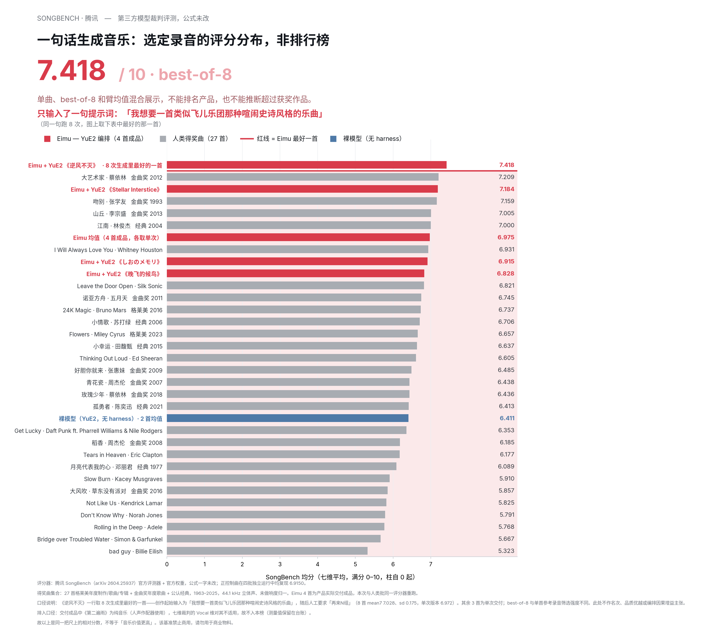
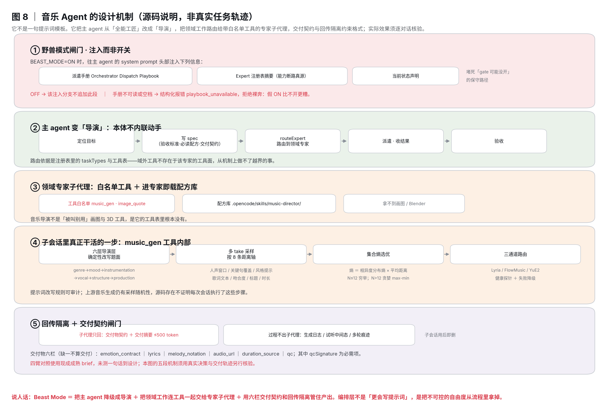
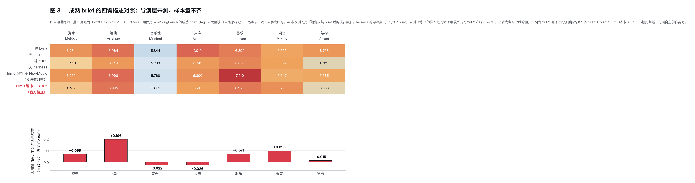
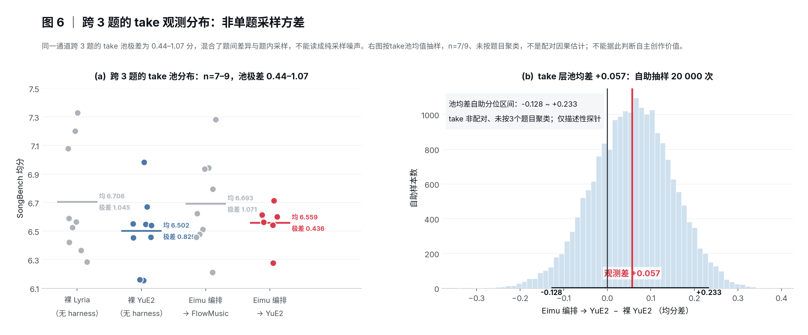

# Eimu Music Agent — 编排层 + 可复现评测

把一句话题面做成一首完整的歌，然后**用一个第三方的模型裁判基准去量它**。

我们在腾讯 [SongBench](https://github.com/Tencent/SongBench) 上做了一次对标：把 27 首格莱美年度制作/歌曲/专辑
+ 金曲奖年度歌曲 + 公认经典的得奖录音，和我方 4 首入榜成品，放进**同一个评分器、同一批口径**打分。

本地历史记录中，“我想要一首类似飞儿乐团那种喧闹史诗风格的乐曲”对应8次候选，最高一首的SongBench均分7.418。它是选优后的特定作品量表结果，**不是官方榜位、真人获奖作品排名或自主创作/编排增益证明**。


**这 7.418 是什么口径，写清楚**：整首歌的输入**只有一句提示词**——

> 我想要一首类似飞儿乐团那种喧闹史诗风格的乐曲

同一句跑 8 次（Beast On Mode +「再来N组」），榜单上取其中**最好的一首**：8 首 mean7 7.028 / sd 0.175，
其单次版本为 6.972。拿 best-of-8 去比单首人类录音是不同筛选强度——但人类得奖作同样经过反复重做、
筛选与母带打磨，所以我们不打算把这个口径藏起来，只是必须写明白。其余 3 首是单次交付。

> 入榜集是 4 首**有人声主唱**的成品。第 5 首《第二遍雨》是纯音乐（人声作配器），SongBench 的 Vocal 维
> 对它不适用，按口径排除出榜——它的分数仍随包提供，不做修改，见 [eval/README.md](eval/README.md)。

[SongBench原论文§2.1/§2.3](https://arxiv.org/html/2604.25937v1)包含真实版权录音，不能将人类母带一概判OOD；本包27首具体录音是否与训练重叠未知。同一评分器不能消除选优次数、输入、时长和分布差异，不恢复获奖曲排名宣传。原始音频、分数与机制代码保留；音乐自主创作的实际证据另见[素材包](../../bench/creative-agent-bench/RELEASE-EVIDENCE.md)。
---

## 这个仓库里有什么

| 目录 | 内容 |
|---|---|
| `agent/` | 编排层核心（6 个 TypeScript 文件，零依赖，只用 Node 内建 + `fetch`） |
| `eval/` | 可复现的评测包：评测器补丁、题面、评分表、我方交付成品的音频 |
| `figs/` | 本文所有图的 PNG / PDF / 生成脚本 |

## Beast Mode 到底怎么运作

它**不是一句提示词模板**。它把主 agent 从「全能工匠」改成「导演」，把领域工作路由给带白名单工具的
专家子代理，再用交付契约与回传隔离把质量管住。



五段（对应实现设计，不等于每个历史会话实际运行；需真实工具轨迹逐次核对）：

1. **闸门是「注入」而非「开关」**。`BEAST_MODE=ON` 时，往主 agent 的 system prompt 头部注入
   派遣手册 + Expert 注册表摘要 + 当前状态声明（堵死模型「gate 可能没开」而走保守路径的藉口）。
   OFF 时一个字都不注入（零回归）；手册不可读或为空则结构化报错 `playbook_unavailable`——
   **拒绝裸奔**，因为假 ON 比不开更糟。
2. **主 agent 降级为导演**：定位目标 → 写 spec（含验收标准、必读配方、交付契约）→
   `routeExpert` 路由 → 派遣 → 收结果 → 验收，**本体不内联动手**。
3. **专家子代理带白名单工具**：音乐导演只有 `music_gen` 和 `image_quote`，拿不到画图与 3D 工具。
   不是「叫它别用」，是工具表里根本没有；进专家即载配方库（must-load），不是「高兴才查」。
4. **子会话里真正干活的是确定性代码**：`music_gen` 工具内部依次是六层导演层（确定性改写题面，
   决定性参数前置）→ 多 take 采样（8 条距离轴）→ 集合熵选优 → 三通道路由。确定性改写可审计；生成/采样仍有随机性，不能承诺同输入得到同一音频。
5. **回传隔离 + 交付契约闸门**：子代理只回交付物契约与 ≤500 token 的摘要，过程（生成日志、
   试听中间态、多轮痕迹）不出子代理、子会话用后即删；交付物六栏
   （`emotion_contract` / `lyrics` / `melody_notation` / `audio_url` / `duration_source` / `qc`）缺一不算交付，
   其中 `qcSignature` 为必需项。

**对照实验声明的落点在这里**：裸臂直送上游，Beast臂意图走编排。实际是否走完五段须看轨迹；Agent可能改写上游载荷，因此不能说两臂实际提示词相同或只差机制。**诚实的结果是：给定一份已经写好的成熟 brief（WildSongBench
那种带tags和完整歌词的题面）时，现有观测没有识别出明确单次净增益（见“那次消融”；不能把不齐样本的池均差直接当因果差）；
代码意图提供多组生成、通道降级与统一交付；具体哪项在该会话生效仍须查轨迹，不能据best-of-8产物反推每项机制运行。
而把「一句话」变成「成熟 brief」的第一段（导演层）在消融里被设成了常量，未测。**

## 快速复现

```bash
cd eval
./install.sh          # 拉 SongBench 官方仓库、打我们的评测器补丁、装依赖
./run.sh              # 转 44.1 kHz 立体声 WAV → 跑官方评分器 → 汇总
./run.sh --score-only # 只重算分数表（跳过推理）
```

## `agent/` 六个文件

| 文件 | 干什么 |
|---|---|
| `music_prompt_director.ts` | 六层风格公式的确定性改写（第 4 段里那一步），纯函数、可审计 |
| `music_tools.ts` | 工具面：任务生命周期、多 take 采样与选优、通道路由与降级 |
| `music_lyria.ts` / `music_flowmusic.ts` / `music_yue2.ts` | 三条上游通道客户端，统一契约 |
| `music_tools_adapter.ts` | 接进宿主运行时的适配层 |

三个通道客户端对外是同一形状，因此**换通道不改编排逻辑**——这是能做「同一道题面、四条通道」
对照实验的前提。接口约定见 [agent/README.md](agent/README.md)。

上游全部走环境变量，**仓库内无任何明文密钥**。

## 那次消融

### 先看这道题面长什么样——它决定了这次消融能证明什么

四臂跑的题面来自 WildSongBench 的 192 条 prompt，四臂逐字节一致（435 字符 / `sha256 7e462c5c…`）。
它**不是一句人类话，而是一份已经写好的成熟 brief**：

```
[Tags] 搞怪,Male Vocals,Mandarin
[Intro: ...] [Verse 1] [Chorus] ...
<完整歌词，逐段带结构标记>
```

风格标签、人声类型、语言、速度、情绪、**完整歌词、段落结构**全都给定。也就是说，
**该题没有直接评“模糊短需求到创作设计”的过程，因为成熟brief已经给定。** 但不能因此断言导演层无事可做或未执行；它仍可能改写上游载荷，须查实际轨迹。

这一点必须先讲，否则下面那张表会被读成「harness 没用」，而它测的根本不是那件事。

### 给定成熟 brief 之后，执行层的净差

3 个题面 × 3 个 take（=`n=9`，一臂因 harvest 缺 2 首为 `n=7`），四条通道：

| 通道 | n | 均分 |
|---|---|---|
| 裸 Lyria（无 harness） | 9 | 6.7063 |
| 裸 YuE2（无 harness） | 9 | 6.5015 |
| Eimu 编排 → FlowMusic | 9 | 6.6926 |
| Eimu 编排 → YuE2 | 7 | 6.5588 |



同题面配对看，编排层相对裸通道是 FlowMusic/Lyria **−0.014**、YuE2 **−0.008**（逐题面配对差
sd 约 0.10–0.12），两条都落在噪声里。**结论只覆盖这批成熟brief的观测**：实际上游载荷、缺失样本和题目权重未完全匹配，不能据此归因于take管理／降级／契约，也不能证明它们没有效果。补满样本前这个区间
在 n=2/4 下就已经跨过 0，补满到 n=7/9 后依然跨过 0：



### 取样杠杆是模型自带的，不是 harness 的独门

把手上的 3 take 按「取最好的一首」重算，四条臂的斜率几乎一样：

| 通道 | 3 take 均分 | 3 take 取最好 | 取样收益 |
|---|---|---|---|
| 裸 Lyria（无 harness） | 6.7063 | 6.8274 | +0.121 |
| 裸 YuE2（无 harness） | 6.5015 | 6.7029 | +0.201 |
| Eimu 编排 → FlowMusic | 6.6926 | 6.8998 | +0.207 |

裸通道 3 取 1 同样能拿到 +0.12~0.20。harness 在这里的贡献是**把这个动作做成一键能力并把
N 拉到 8**（《逆风不灭》同一句跑 8 次取最好，单次 6.972 → **7.418**，+0.446，榜单第一名）。
人类工作室提升品质靠的也是反复重做＋挑最好的，不是一次成神——产品定位与这条数据一致。

### 换一把尺：感知尺对「有没有照着题面唱」是结构性失明的

SongBench 和 SongEval 都是「听起来好不好」的感知裁判。但用户交的是一份**写明歌词与标签的 brief**，
产品要交付的第一件事是**照着唱**——而这句话不在任何感知尺的量程里。所以我们又加了一把
**客观、免费、可复现**的尺：把题面里写给模型的歌词当 ground truth，用 ASR 转写成品，算字符级召回
（`analysis/asr-lyric-fidelity.py`）。同一批 34 首音频，三把尺：

| 尺 | 量的是什么 | 裸 Lyria | 编排→FlowMusic | 编排→YuE2 | 裸 YuE2 | 编排/裸 同通道净差 |
|---|---|---|---|---|---|---|
| SongBench（7 维） | 听起来好不好 | 6.7063 | 6.6926 | 6.5588 | 6.5015 | −0.008 ~ −0.014 |
| SongEval（5 维，另一把独立感知尺） | 听起来好不好 | 4.4488 | 4.3162 | 4.3098 | 4.3768 | −0.067 ~ −0.133 |
| **歌词保真（ASR 字符召回）** | **有没有照着题面唱** | **0.308** | **0.580** | **0.641** | **0.721** | −0.071 |

两件事同时成立：

1. **两把感知尺的局部结果同向**——该批观测差接近0，只能说明现有条件下未见明确收益；不证明感知轴无收益，也不证明两把尺误差独立。
2. **同一批音频在「照着唱」这条轴上差 7 倍**（英文题面：裸 Lyria 唱出 13% 的歌词，走对通道是 80–92%），
   而两把感知尺对这 7 倍**完全失明**。

**差距来自哪一环要说清楚**：拉开它的是**通道/路由选择**（编排→FlowMusic 相对裸 Lyria +0.273，
英文题面 +0.674），不是编排层的生成期干预——同一通道对照（编排→YuE2 vs 裸 YuE2）净差 −0.071。
换句话说：**「帮你选到能唱你这首歌的通道」是真实且巨大的价值；「编排层让同一个模型唱得更好」
三把尺一致没测出来。** 这两件事以前被一句「harness 有没有用」糊在一起，现在分开了。

### 这次消融**没有**测到的那条腿（也是产品主线的那条）

产品主线的因果链是：**人类只说一句话 → 导演层把它变成上面那种 brief → 出歌**。
榜单第一的 7.418 走的就是这条链（输入只有一句「我想要一首类似飞儿乐团那种喧闹史诗风格的乐曲」）。

而这次消融把链条的第二环**设为常量并给了所有臂**，等于把导演层的贡献归零后再比。
所以它既不能证明导演层有用，也不能证明导演层没用——**这条腿目前是未测状态，不是已证伪状态。**

**要补的实验（便宜，需要时再跑）**：同一句人类口语提示词，两条臂——
① 裸臂：那句话直接打上游，单次；② harness 臂：走完整链路。
harness 臂已有现成的（《逆风不灭》单次 6.972 / best-of-8 7.418），缺的只是裸臂。
量的时候**要用「照着唱」那把尺＋感知尺一起量**，不要只看感知尺——上面已经证明感知尺会对
这条轴上的巨大差异失明。跑完这个，才能对「harness 到底有没有用」下结论；在那之前，任何一边的
结论都是抢跑。

## 更多图

- [逐曲 × 逐维全量矩阵](figs/ZH-1-heatmap.png) — 31 个条目 × 7 个维度，末两行是得奖曲列均值与裸模型基线
- [七个维度各自的分布](figs/ZH-2-dimdist.png) — Eimu 的成品落在得奖曲分布的哪一段
- [四条通道的逐维标准化画像](figs/ZH-7-profile.png) — 相对得奖曲分布，谁在哪一维真正越过了日常波动
- [评测流程与守门件](figs/ZH-5-process.png)
- [方法与可信度](figs/ZH-4-method.png)

## 许可

- 本仓库我方代码：MIT（见 [LICENSE](LICENSE)）
- SongBench 及其权重：**仅限学术用途，禁止任何商业或生产用途**，见 [NOTICE.md](NOTICE.md)
- 人类得奖曲音频**受版权保护，不随仓库分发**，只公开曲目元数据与分数
- `eval/audio/` 中是我方自己生成的成品，按 MIT 提供

## 引用

```
SongBench: A Fine-Grained Multi-Aspect Benchmark for Song Quality Assessment
Tencent, arXiv 2604.25937
```